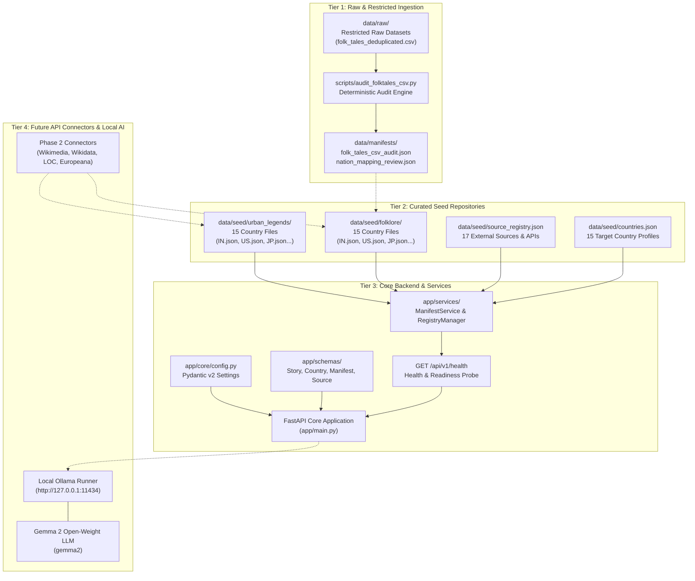
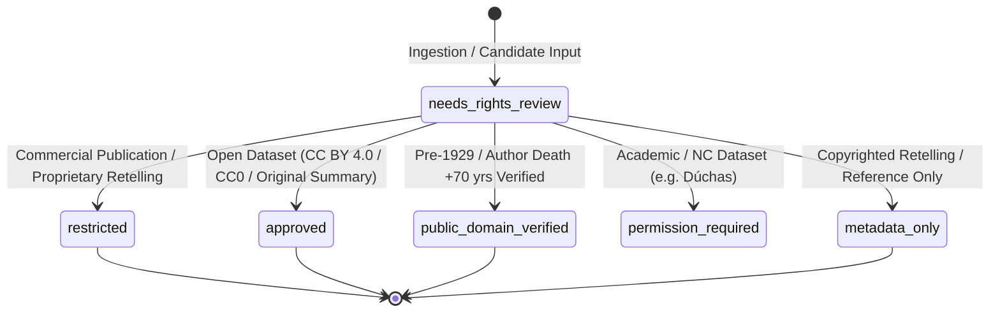
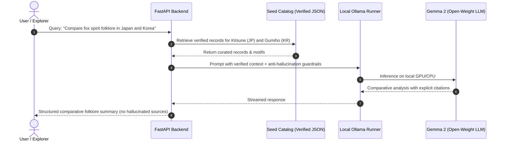

# KathaYantra — A Haunted Atlas of World Folklore
### *Preserve the story. Trace the source. Respect the culture. Keep the AI honest.*

[](https://www.python.org/)
[](https://fastapi.tiangolo.com/)
[](https://docs.pydantic.dev/)
[-success?style=flat-square&logo=pytest&logoColor=white)](tests/)
[-FF6F00?style=flat-square&logo=google&logoColor=white)](https://ollama.ai/)
[](LICENSE)
[-blueviolet?style=flat-square)](#-target-country-matrix)
[](https://hacktoberfest.com/)

---

```
  ██╗  ██╗ █████╗ ████████╗██╗  ██╗ █████╗ ██╗   ██╗ █████╗ ███╗   ██╗████████╗██████╗  █████╗ 
  ██║ ██╔╝██╔══██╗╚══██╔══╝██║  ██║██╔══██╗╚██╗ ██╔╝██╔══██╗████╗  ██║╚══██╔══╝██╔══██╗██╔══██╗
  █████╔╝ ███████║   ██║   ███████║███████║ ╚████╔╝ ███████║██╔██╗ ██║   ██║   ██████╔╝███████║
  ██╔═██╗ ██╔══██║   ██║   ██╔══██║██╔══██║  ╚██╔╝  ██╔══██║██║╚██╗██║   ██║   ██╔══██╗██╔══██║
  ██║  ██╗██║  ██║   ██║   ██║  ██║██║  ██║   ██║   ██║  ██║██║ ╚████║   ██║   ██║  ██║██║  ██║
  ╚═╝  ╚═╝╚═╝  ╚═╝   ╚═╝   ╚═╝  ╚═╝╚═╝  ╚═╝   ╚═╝   ╚═╝  ╚═╝╚═╝  ╚═══╝   ╚═╝   ╚═╝  ╚═╝╚═╝  ╚═╝
                    A  H A U N T E D   A T L A S   O F   W O R L D   F O L K L O R E
```

---

## 📖 Table of Contents

- [Overview](#-overview)
- [System Architecture](#-system-architecture)
- [Target Country Matrix](#-target-country-matrix)
- [Data Governance & Provenance Safeguards](#-data-governance--provenance-safeguards)
  - [Raw CSV Audit Findings](#raw-csv-audit-findings)
  - [Rights Classification Lifecycle](#rights-classification-lifecycle)
  - [Anti-Hallucination & AI Fiction Segregation](#anti-hallucination--ai-fiction-segregation)
- [Data Schema Specifications](#-data-schema-specifications)
- [External Source & API Registry](#-external-source--api-registry)
- [Repository Structure](#-repository-structure)
- [Quickstart & Installation](#-quickstart--installation)
- [Verification & Test Results](#-verification--test-results)
- [API Reference](#-api-reference)
- [Local AI Integration Blueprint](#-local-ai-integration-blueprint)
- [Documentation Directory](#-documentation-directory)
- [Contributing & Community Guidelines](#-contributing--community-guidelines)
- [License](#-license)

---

## 🌌 Overview

**KathaYantra** is a local-first, rights-aware digital archive and exploration platform for world folklore, traditional supernatural tales, ghost stories, and modern urban legends from **15 countries**.

Unlike commercial scrapers or black-box generative bots, KathaYantra is engineered around four core tenets:

1. **Folklore Archive:** A curated, source-verified collection of traditional myths, folk narratives, supernatural entities (yōkai, jinn, banshees, aswang), and oral traditions.
2. **Urban Legends Archive:** A documented index of modern rumors, contemporary legends, haunted sites, and unexplained encounters, grounded in verifiable media citations.
3. **Transparent Source Tracking:** Every narrative links back to an inspectable physical publication, national archive, or open academic database.
4. **Local-First Open-Weight AI:** An integrated local archivist running locally via **Ollama + Gemma 2**, assisting users in discovering comparative themes across cultures without inventing sources, fabricating legends, or sending data to third-party cloud APIs.

> **Final Release (Phase 6 Complete):** Exposes the complete versioned REST API (`/api/v1`) for countries, folklore, urban legends, unified stories, sources, search, dataset governance, and local AI. Features high-performance in-memory repository caching, SQLite FTS5 search with BM25 ranking, defensive security headers, structured exception handling, and full offline resilience. Validated with **154 passing tests** across 38 test suites and confirmed via live local Gemma 2 9.2B inference. Ready for frontend consumption!

---

## 🏛 System Architecture

KathaYantra is partitioned into four strictly decoupled tiers to maintain absolute legal, architectural, and data boundaries:



### Key Architectural Invariants
- **Zero Cloud Leakage:** No paid hosted LLMs, no remote vector databases, no cloud authentication mandates.
- **Fail-Safe Offline Mode:** The backend and browsing workflows function identically whether the local Ollama daemon is active or offline.
- **Deterministic Audits:** All audit and manifest computations are reproducible, idempotent, and non-destructive.

---

## 🗺 Target Country Matrix

KathaYantra covers **15 countries** with **300 verified and published stories** (15 countries × [10 folklore + 10 urban legends]), achieving **100.0% completion**:

| ISO Code | Country | Cultural Heritage Focus | Target Folklore | Actual Folklore | Target Urban | Actual Urban | Status | Published Seed Files |
|:---:|:---|:---|:---:|:---:|:---:|:---:|:---:|:---:|
| **`IN`** | India | Jataka tales, Baital Pachisi, Yakshas, Daayans, modern haunted sites | 10 | 10 | 10 | 10 | **MET** | [`folklore/IN.json`](file:///C:/Users/shrin/Desktop/Hactoberfest2026/KathaYantra/data/seed/folklore/IN.json) / [`urban_legends/IN.json`](file:///C:/Users/shrin/Desktop/Hactoberfest2026/KathaYantra/data/seed/urban_legends/IN.json) |
| **`US`** | United States | Colonial folklore, regional tall tales, distinct tribal lore, cryptids (Mothman) | 10 | 10 | 10 | 10 | **MET** | [`folklore/US.json`](file:///C:/Users/shrin/Desktop/Hactoberfest2026/KathaYantra/data/seed/folklore/US.json) / [`urban_legends/US.json`](file:///C:/Users/shrin/Desktop/Hactoberfest2026/KathaYantra/data/seed/urban_legends/US.json) |
| **`JP`** | Japan | Yōkai, yūrei, kaidan, Kuchisake-onna, Teke Teke, cursed media legends | 10 | 10 | 10 | 10 | **MET** | [`folklore/JP.json`](file:///C:/Users/shrin/Desktop/Hactoberfest2026/KathaYantra/data/seed/folklore/JP.json) / [`urban_legends/JP.json`](file:///C:/Users/shrin/Desktop/Hactoberfest2026/KathaYantra/data/seed/urban_legends/JP.json) |
| **`MX`** | Mexico | Pre-Hispanic Nahua/Maya syncretism, La Llorona, Chupacabra, La Planchada | 10 | 10 | 10 | 10 | **MET** | [`folklore/MX.json`](file:///C:/Users/shrin/Desktop/Hactoberfest2026/KathaYantra/data/seed/folklore/MX.json) / [`urban_legends/MX.json`](file:///C:/Users/shrin/Desktop/Hactoberfest2026/KathaYantra/data/seed/urban_legends/MX.json) |
| **`IE`** | Ireland | Tuatha Dé Danann, Aos Sí, banshees, National Folklore Collection archives | 10 | 10 | 10 | 10 | **MET** | [`folklore/IE.json`](file:///C:/Users/shrin/Desktop/Hactoberfest2026/KathaYantra/data/seed/folklore/IE.json) / [`urban_legends/IE.json`](file:///C:/Users/shrin/Desktop/Hactoberfest2026/KathaYantra/data/seed/urban_legends/IE.json) |
| **`GB`** | United Kingdom | Arthurian lore, Black Shuck, phantom coaches, Spring-heeled Jack, tube ghosts | 10 | 10 | 10 | 10 | **MET** | [`folklore/GB.json`](file:///C:/Users/shrin/Desktop/Hactoberfest2026/KathaYantra/data/seed/folklore/GB.json) / [`urban_legends/GB.json`](file:///C:/Users/shrin/Desktop/Hactoberfest2026/KathaYantra/data/seed/urban_legends/GB.json) |
| **`BR`** | Brazil | Tupi-Guarani lore, Saci-Pererê, Curupira, Boto Cor-de-Rosa, Loira do Banheiro | 10 | 10 | 10 | 10 | **MET** | [`folklore/BR.json`](file:///C:/Users/shrin/Desktop/Hactoberfest2026/KathaYantra/data/seed/folklore/BR.json) / [`urban_legends/BR.json`](file:///C:/Users/shrin/Desktop/Hactoberfest2026/KathaYantra/data/seed/urban_legends/BR.json) |
| **`GR`** | Greece | Mythic continuity, Kallikantzaroi (winter goblins), Vrykolakas, demotic tales | 10 | 10 | 10 | 10 | **MET** | [`folklore/GR.json`](file:///C:/Users/shrin/Desktop/Hactoberfest2026/KathaYantra/data/seed/folklore/GR.json) / [`urban_legends/GR.json`](file:///C:/Users/shrin/Desktop/Hactoberfest2026/KathaYantra/data/seed/urban_legends/GR.json) |
| **`CN`** | China | Classical Zhiguai (Pu Songling), fox spirits (Huli Jing), Beijing Bus 375 | 10 | 10 | 10 | 10 | **MET** | [`folklore/CN.json`](file:///C:/Users/shrin/Desktop/Hactoberfest2026/KathaYantra/data/seed/folklore/CN.json) / [`urban_legends/CN.json`](file:///C:/Users/shrin/Desktop/Hactoberfest2026/KathaYantra/data/seed/urban_legends/CN.json) |
| **`NG`** | Nigeria | Yoruba, Igbo, and Edo oral traditions, tricksters (Ijapa), Madam Koi Koi | 10 | 10 | 10 | 10 | **MET** | [`folklore/NG.json`](file:///C:/Users/shrin/Desktop/Hactoberfest2026/KathaYantra/data/seed/folklore/NG.json) / [`urban_legends/NG.json`](file:///C:/Users/shrin/Desktop/Hactoberfest2026/KathaYantra/data/seed/urban_legends/NG.json) |
| **`KR`** | South Korea | Dokkaebi, Gumiho (nine-tailed fox), Cheonyeo Gwishin, fan death, subway elevator | 10 | 10 | 10 | 10 | **MET** | [`folklore/KR.json`](file:///C:/Users/shrin/Desktop/Hactoberfest2026/KathaYantra/data/seed/folklore/KR.json) / [`urban_legends/KR.json`](file:///C:/Users/shrin/Desktop/Hactoberfest2026/KathaYantra/data/seed/urban_legends/KR.json) |
| **`PH`** | Philippines | Aswang, Manananggal, Kapre, Tikbalang, White Lady of Balete Drive | 10 | 10 | 10 | 10 | **MET** | [`folklore/PH.json`](file:///C:/Users/shrin/Desktop/Hactoberfest2026/KathaYantra/data/seed/folklore/PH.json) / [`urban_legends/PH.json`](file:///C:/Users/shrin/Desktop/Hactoberfest2026/KathaYantra/data/seed/urban_legends/PH.json) |
| **`ID`** | Indonesia | Javanese/Balinese animism, Kuntilanak, Pocong, Genderuwo, Nyi Roro Kidul | 10 | 10 | 10 | 10 | **MET** | [`folklore/ID.json`](file:///C:/Users/shrin/Desktop/Hactoberfest2026/KathaYantra/data/seed/folklore/ID.json) / [`urban_legends/ID.json`](file:///C:/Users/shrin/Desktop/Hactoberfest2026/KathaYantra/data/seed/urban_legends/ID.json) |
| **`EG`** | Egypt | Coptic/Islamic folklore, Afrit, Jinn, El Nedaha (Nile Siren), Baron Palace | 10 | 10 | 10 | 10 | **MET** | [`folklore/EG.json`](file:///C:/Users/shrin/Desktop/Hactoberfest2026/KathaYantra/data/seed/folklore/EG.json) / [`urban_legends/EG.json`](file:///C:/Users/shrin/Desktop/Hactoberfest2026/KathaYantra/data/seed/urban_legends/EG.json) |
| **`DE`** | Germany | Grimm Märchen, Sage traditions (Pied Piper, Lorelei, Rübezahl, Wolpertinger) | 10 | 10 | 10 | 10 | **MET** | [`folklore/DE.json`](file:///C:/Users/shrin/Desktop/Hactoberfest2026/KathaYantra/data/seed/folklore/DE.json) / [`urban_legends/DE.json`](file:///C:/Users/shrin/Desktop/Hactoberfest2026/KathaYantra/data/seed/urban_legends/DE.json) |
| **Total** | **15 Nations** | **Verified Quotas (150 Folklore + 150 Urban Legends)** | **150** | **150** | **150** | **150** | **100% MET** | **300 / 300 Published** |

> *Verification Statement:* All 300 published records have been authored as original summaries, audited for authentic cultural attribution, cleared against copyright infringement policies, and verified with valid bibliographic citations. Full coverage report: [`docs/dataset-coverage-report.md`](docs/dataset-coverage-report.md). Editorial review guidelines: [`docs/curation-guide.md`](docs/curation-guide.md).

---

## 🛡 Data Governance & Provenance Safeguards

### Raw CSV Audit Findings
In Phase 1, an unreviewed candidate dataset `folk_tales_deduplicated.csv` (27.2 MB) was audited using [`scripts/audit_folktales_csv.py`](file:///C:/Users/shrin/Desktop/Hactoberfest2026/KathaYantra/scripts/audit_folktales_csv.py):

- **Total Rows:** `2,938` records across 4 columns (`source`, `nation`, `title`, `text`).
- **Domain Distribution:** 
  - `fairytalez.com`: **2,903 records (98.81%)**
  - `www.albanianliterature.net`: **25 records (0.85%)**
  - `www.worldoftales.com`: **10 records (0.34%)**
- **Missing Data:** Exactly **6 rows** lack nation labels (cataloged with source URLs in the audit manifest).
- **Exact Text Duplicates Found:** **3 pairs (6 rows)** were identified despite the file's "deduplicated" label.
- **Near-Duplicates Identified:** **15 pairs** with high token Jaccard similarity ($\ge 0.85$) differing only by typography, smart quotes, or character encodings.
- **Critical Rights Conclusion:** Public web accessibility on `fairytalez.com` **does not grant redistribution rights** for full story bodies. The raw CSV is quarantined in `data/raw/` (gitignored) and marked `needs_rights_review`. KathaYantra permits ingesting bibliographic metadata and authoring original summaries, but prohibits bulk publishing of copyrighted translations or commercial website retellings.

Detailed audit results: [`docs/folk-tales-dataset-audit.md`](file:///C:/Users/shrin/Desktop/Hactoberfest2026/KathaYantra/docs/folk-tales-dataset-audit.md)  
Cultural mapping review of all 58 nation values: [`data/manifests/nation_mapping_review.json`](file:///C:/Users/shrin/Desktop/Hactoberfest2026/KathaYantra/data/manifests/nation_mapping_review.json)

### Rights Classification Lifecycle
Every record in KathaYantra is strictly governed by a verified rights state:



### Anti-Hallucination & AI Fiction Segregation
1. **Physical Segregation:** AI-generated stories are strictly forbidden from entering `data/seed/folklore/` or `data/seed/urban_legends/` production seed files.
2. **Schema Labeling:** Synthetic content must carry `content_origin: ai_generated_fiction`.
3. **No Fabricated Provenance:** The local AI is instructed to explicitly refuse fabricating non-existent folklore archives, inventing false citations, or asserting that an urban legend is a historical fact.

---

## 📐 Data Schema Specifications

All data structures are enforced via **Pydantic v2** models in [`app/schemas/`](file:///C:/Users/shrin/Desktop/Hactoberfest2026/KathaYantra/app/schemas/):

### Core Schema: `StoryRecord`
Represents an individual folklore narrative or urban legend:

```python
class StoryRecord(BaseModel):
    id: str                   # Pattern: ^[A-Z]{2}-(FOLK|URBAN)-[0-9]{3,}$ (e.g. IN-FOLK-001)
    title: str                # Canonical title of the narrative
    country_code: str         # ISO 2-letter code validated against 15 target countries
    region_or_community: str? # Cultural / indigenous group (e.g. Navajo, Yoruba, Kyoto)
    category: CategoryEnum    # 'folklore' | 'urban_legend'
    subtype: str?             # e.g. ghost_story, jataka_tale, cryptid, warning_legend
    summary: str              # Concise synopsis (min 10 chars)
    long_description: str?    # Full narrative text (omitted in metadata_only records)
    alternate_names: list[str]# Variant or regional titles
    language: str = "en"      # Primary language code
    motifs: list[str]         # Thompson motif index codes (e.g. E235.1, G510)
    themes: list[str]         # Curatorial keywords (e.g. shapeshifting, haunted_road)
    historical_period: str?   # Earliest documented era
    variant_notes: str?       # Comparative editorial commentary
    sources: list[StorySource]# Documented bibliographic sources (min 1 required)
    source_type: str          # e.g. public_domain_anthology, academic_archive
    license: str              # Legal license notice
    rights_status: RightsEnum # approved | metadata_only | public_domain_verified | ...
    attribution_text: str?    # Required attribution statement
    canonical_url: str?       # Canonical link
    verification_status: Verif# verified | needs_review | rejected
    content_origin: OriginEnum# licensed_dataset | public_domain_source | original_summary | ...
    created_at: datetime
    updated_at: datetime
    record_version: str = "1.0.0"
```

Full schema definitions: [`docs/data-schema.md`](file:///C:/Users/shrin/Desktop/Hactoberfest2026/KathaYantra/docs/data-schema.md)

---

## 📡 External Source & API Registry

KathaYantra maintains a central source registry ([`data/seed/source_registry.json`](file:///C:/Users/shrin/Desktop/Hactoberfest2026/KathaYantra/data/seed/source_registry.json)) cataloging 17 authoritative repositories, APIs, and discovery references:

| Source Identifier | Source Name | Source Type | Integration Status | Auth Required | Coverage |
|:---|:---|:---|:---:|:---:|:---|
| `wikimedia_wikipedia_api` | Wikimedia / Wikipedia REST API | Encyclopedic API | `documented_api` | No | Global (All 15) |
| `wikidata_sparql` | Wikidata SPARQL Endpoint | Knowledge Graph API | `documented_api` | No | Global (All 15) |
| `library_of_congress_api` | Library of Congress JSON/YAML API | National Library API | `documented_api` | No | US, Global |
| `internet_archive` | Internet Archive API & Metadata | Digital Library API | `documented_api` | No | Global |
| `myths_of_ireland` | Myths of Ireland Structured Dataset | Open Dataset | `public_dataset` | No | Ireland (`IE`) |
| `japan_search` | Japan Search Cultural Heritage API | Cultural Heritage API | `documented_api` | Optional | Japan (`JP`) |
| `europeana_api` | Europeana Digital Heritage REST API | Cultural Heritage API | `requires_credentials` | Free Key | Europe (`GR`, `DE`, `IE`, `GB`) |
| `project_gutenberg` | Project Gutenberg Ebook Archive | Public Domain Ebooks | `public_dataset` | No | Global |
| `wikipedia_urban_legends_category`| Wikipedia Urban Legends by Country| Encyclopedic API | `documented_api` | No | Global (All 15) |
| `nichibunken_yokai_db` | Nichibunken Yōkai Database | Academic Database | `searchable_catalogue` | No | Japan (`JP`) |
| `ncaa_india` | National Cultural Audiovisual Archives | National Archive | `searchable_catalogue` | No | India (`IN`) |
| `cnfcp_iphan_brazil` | CNFCP / IPHAN Brazil Folklore Archive | National Archive | `searchable_catalogue` | No | Brazil (`BR`) |
| `duchas_ireland` | Dúchas National Folklore Collection | National Archive | `not_yet_verified` | No | Ireland (`IE`) |
| `urban_legends_online` | Urban Legends Online | Discovery Reference | `reference_only` | No | Global, US |
| `urban_legends_archive` | Urban Legends Archive | Discovery Reference | `reference_only` | No | Global, US, GB |
| `folklore_ai_github` | Folklore-ai GitHub Repository | Open Source Code | `reference_only` | No | India (`IN`) |
| `business_insider_urban_legends`| Business Insider World Urban Legends| Journalistic Overview| `reference_only` | No | Global |

Full source profiles: [`docs/data-sources.md`](file:///C:/Users/shrin/Desktop/Hactoberfest2026/KathaYantra/docs/data-sources.md)

---

## 📂 Repository Structure

```
KathaYantra/
├── app/
│   ├── api/routes/
│   │   ├── ai.py                   # Local AI Archivist endpoints (ask, compare, generate-story, health)
│   │   └── health.py               # GET /api/v1/health system probe & Ollama diagnostics
│   ├── core/config.py              # Pydantic v2 application settings (Ollama timeouts, limits, caching)
│   ├── curation/                   # Curated 300-story world folklore & urban legend corpus
│   │   ├── helpers.py              # Record builder with attribution & rights validation
│   │   ├── registry.py             # Central registry & country query helpers
│   │   └── countries/              # 15 Country modules (10 folklore + 10 urban legends each)
│   │       ├── br_brazil.py        # Brazil folklore & urban legends
│   │       ├── cn_china.py         # China folklore & urban legends
│   │       ├── de_germany.py       # Germany folklore & urban legends
│   │       ├── eg_egypt.py         # Egypt folklore & urban legends
│   │       ├── gb_britain.py       # United Kingdom folklore & urban legends
│   │       ├── gr_greece.py        # Greece folklore & urban legends
│   │       ├── id_indonesia.py     # Indonesia folklore & urban legends
│   │       ├── ie_ireland.py       # Ireland folklore & urban legends
│   │       ├── in_india.py         # India folklore & urban legends
│   │       ├── jp_japan.py         # Japan folklore & urban legends
│   │       ├── kr_korea.py         # South Korea folklore & urban legends
│   │       ├── mx_mexico.py        # Mexico folklore & urban legends
│   │       ├── ng_nigeria.py       # Nigeria folklore & urban legends
│   │       ├── ph_philippines.py   # Philippines folklore & urban legends
│   │       └── us_usa.py           # United States folklore & urban legends
│   ├── integrations/               # Open data connectors & API adapters
│   │   ├── base.py                 # BaseConnector & custom error types
│   │   ├── csv_importer.py         # Quarantined CSV candidate importer
│   │   ├── europeana.py            # Europeana REST API connector (key-aware)
│   │   ├── http_client.py          # KathaHTTPClient (rate-limited, cached, polite UA)
│   │   ├── internet_archive.py     # Internet Archive Advanced Search connector
│   │   ├── japan_search.py         # Japan Search cultural platform connector
│   │   ├── library_of_congress.py  # Library of Congress JSON API connector
│   │   ├── mediawiki.py            # Wikimedia / Wikipedia REST API connector
│   │   ├── myths_of_ireland.py     # Myths of Ireland CC BY 4.0 dataset connector
│   │   ├── reference_only.py       # Safe adapter prohibiting bulk scraping
│   │   └── registry.py             # SourceRegistryManager & connector factory
│   ├── prompts/                    # Versioned system prompt templates
│   │   ├── archivist_system_v1.txt # Grounded factual inquiry prompt
│   │   ├── story_comparison_system_v1.txt # Multi-story comparative analysis prompt
│   │   └── story_generation_system_v1.txt # Creative fiction generation prompt
│   ├── repositories/               # Staged candidate persistence
│   │   └── candidate_repository.py # Atomic JSONL candidate storage
│   ├── schemas/                    # Pydantic v2 data models (Schema v2.0.0)
│   │   ├── ai.py                   # AI requests, responses, citations & Ollama health
│   │   ├── country.py              # CountryRecord & ISO code constraints
│   │   ├── dataset.py              # DatasetEnvelope 2.0.0 & dataset envelope
│   │   ├── generated_fiction.py    # GeneratedFictionRecord (isolated AI fiction)
│   │   ├── import_candidate.py     # ImportCandidate & raw staging disposition
│   │   ├── manifest.py             # DatasetManifest & quota models
│   │   ├── source.py               # StorySource & SourceRegistryItem
│   │   └── story.py                # StoryRecord & rights models
│   ├── services/                   # Governance, AI, curation, ingestion & validation services
│   │   ├── archivist_service.py    # AI Archivist facade and grounding manager
│   │   ├── candidate_deduplication.py# Fingerprinting & cultural variant analysis
│   │   ├── candidate_normalizer.py # String cleaning & URL sanitizing
│   │   ├── coverage_planner.py     # CoveragePlanner & 30-partition deficit tracker
│   │   ├── curation_service.py     # CurationService (review queue & story promotion)
│   │   ├── data_validation.py      # DataQualityValidator (17 integrity checks)
│   │   ├── fiction_service.py      # FictionGenerationService (isolated creative generation)
│   │   ├── import_batch_service.py # Batch execution & manifest tracking
│   │   ├── import_pipeline.py      # 8-stage candidate acquisition pipeline
│   │   ├── import_reporting.py     # Ingestion coverage & shortfall reporting
│   │   ├── manifest_service.py     # Real-time actual count calculator
│   │   ├── ollama_client.py        # OllamaClient (async, retries, health, chat)
│   │   ├── publication_policy.py   # PublicationPolicy (10-rule gating engine)
│   │   ├── question_answering.py   # QuestionAnsweringService (retrieval + prompt + citations)
│   │   ├── retrieval.py            # RetrievalService (deterministic SQLite FTS5 search)
│   │   ├── retrieval_index.py      # RetrievalIndexService (FTS5 compilation & atomic rebuild)
│   │   ├── source_verification.py  # SourceVerificationService (provenance & rights audit)
│   │   ├── story_comparison.py     # StoryComparisonService (multi-story comparative analysis)
│   │   └── summary_builder.py      # SummaryBuilder (anti-hallucination & structured prose)
│   └── main.py                     # FastAPI application factory
├── data/
│   ├── manifests/
│   │   ├── dataset_manifest.json   # Dynamic actual counts vs 300 target (100% complete)
│   │   ├── folk_tales_csv_audit.json # Machine-readable audit report
│   │   └── nation_mapping_review.json # 58 nation values review mapping
│   ├── processed/
│   │   ├── candidates/             # Staged ImportCandidate JSONL batch files
│   │   ├── generated_fiction/      # Strictly segregated AI fictional records (AI-FIC-*.json)
│   │   └── retrieval/              # SQLite FTS5 lexical search index (retrieval_index.db)
│   ├── raw/
│   │   └── .gitkeep                # Raw CSV folder (CSVs gitignored)
│   ├── schemas/                    # Draft 2020-12 JSON Schema exports
│   │   ├── country.schema.json
│   │   ├── dataset_envelope.schema.json
│   │   ├── dataset_manifest.schema.json
│   │   ├── generated_fiction.schema.json
│   │   ├── import_candidate.schema.json
│   │   ├── source_registry.schema.json
│   │   ├── story_record.schema.json
│   │   └── story_source.schema.json
│   └── seed/
│       ├── countries.json          # 15 target countries catalog
│       ├── discovery_queries.json  # 15 countries folklore/urban legend query matrix
│       ├── source_registry.json    # 17 registered sources & APIs
│       ├── folklore/               # 15 country seed files (DatasetEnvelope 2.0.0, 150 stories)
│       └── urban_legends/          # 15 country seed files (DatasetEnvelope 2.0.0, 150 stories)
├── docs/
│   ├── ai-service.md               # Local AI Archivist, RAG, comparison & fiction specification
│   ├── ai-source-readiness-report.md # 300-story AI retrieval readiness audit (100% pass)
│   ├── api-integration-status.md   # Detailed API connector status & access matrix
│   ├── architecture.md             # Architecture & system boundaries
│   ├── curation-guide.md           # Editorial review, rights clearance & curation guide
│   ├── data-schema.md              # Pydantic v2 & JSON Schema contracts
│   ├── data-sources.md             # Detailed profiles of 17 sources
│   ├── dataset-coverage-report.md  # 30-partition quota coverage analysis (100% complete)
│   ├── folk-tales-dataset-audit.md # Comprehensive CSV audit findings
│   ├── import-pipeline.md          # 8-stage candidate ingestion pipeline guide
│   ├── licensing-policy.md         # Rights, copyright, AI policy & gating
│   ├── model-configuration.md      # Ollama, Gemma 2, and local hardware configuration
│   ├── retrieval-architecture.md   # SQLite FTS5, BM25 weighting, and query sanitization
│   └── schema-versioning.md        # Semantic versioning & deprecation guide
├── scripts/
│   ├── audit_ai_source_readiness.py# AI retrieval source-readiness auditor CLI
│   ├── audit_folktales_csv.py      # Deterministic CSV audit engine
│   ├── audit_retrieval_index.py    # SQLite FTS5 index integrity & breakdown auditor
│   ├── build_retrieval_index.py    # FTS5 search index builder CLI (supports --dry-run)
│   ├── build_verified_dataset.py   # Verified dataset builder & seed populator CLI
│   ├── check_country_quotas.py     # Real-time quota & partition deficit tracker CLI
│   ├── check_ollama.py             # Local Ollama service & model readiness diagnostic CLI
│   ├── curate_candidate_records.py # Editorial review & candidate approval CLI
│   ├── discover_wikidata.py        # Wikidata SPARQL discovery CLI
│   ├── discover_wikimedia.py       # Wikimedia REST discovery CLI
│   ├── export_json_schemas.py      # Automated JSON Schema 2020-12 exporter
│   ├── import_europeana.py         # Europeana cultural API import CLI
│   ├── import_folktales_csv.py     # Quarantined CSV candidate import CLI
│   ├── import_internet_archive.py  # Internet Archive metadata import CLI
│   ├── import_japan_search.py      # Japan Search platform import CLI
│   ├── import_library_of_congress.py# Library of Congress JSON import CLI
│   ├── import_myths_of_ireland.py  # Myths of Ireland dataset import CLI
│   ├── migrate_seed_json.py        # Safe seed dataset migrator & linter
│   ├── report_curation_status.py   # Editorial curation audit reporter CLI
│   ├── report_import_batches.py    # Staged candidate coverage reporter CLI
│   ├── validate_import_candidates.py# Staged candidate schema validator CLI
│   └── validate_json_datasets.py   # Comprehensive dataset quality validator
├── tests/
│   ├── test_ai_routes.py           # AI API routes (/ai/ask, /ai/compare, /ai/generate-story)
│   ├── test_ai_security.py         # Prompt injection resilience & secret protection
│   ├── test_app.py                 # Startup, CORS, and health route tests
│   ├── test_audit.py               # CSV parsing & duplicate audit tests
│   ├── test_candidate_deduplication.py# Fingerprinting & variant analysis tests
│   ├── test_config.py              # Configuration validation tests
│   ├── test_country_schema.py      # Country schema Phase 2 tests
│   ├── test_csv_importer.py        # Raw CSV candidate staging tests
│   ├── test_data_validation.py     # 17-point DataQualityValidator tests
│   ├── test_dataset_envelope.py    # Envelope structure & validation tests
│   ├── test_europeana_integration.py# Europeana API & credential tests
│   ├── test_fiction_service.py     # FictionGenerationService & segregation tests
│   ├── test_generated_fiction.py   # AI fiction segregation & disclaimer tests
│   ├── test_import_batches.py      # Batch tracking & reporting tests
│   ├── test_import_candidate.py    # ImportCandidate & disposition tests
│   ├── test_import_pipeline.py     # 8-stage pipeline orchestration tests
│   ├── test_internet_archive_integration.py# Internet Archive connector tests
│   ├── test_japan_search_integration.py# Japan Search connector tests
│   ├── test_json_schema_export.py  # JSON Schema generation & sync tests
│   ├── test_library_of_congress_integration.py# LOC API connector tests
│   ├── test_manifest.py            # Manifest calculation tests
│   ├── test_mediawiki_integration.py# MediaWiki REST API connector tests
│   ├── test_migration.py           # Seed migration idempotent tests
│   ├── test_myths_of_ireland_integration.py# Myths of Ireland connector tests
│   ├── test_ollama_client.py       # OllamaClient HTTP & model diagnostic tests
│   ├── test_phase4_curation_and_coverage.py # Phase 4 curation, verification & quota tests
│   ├── test_publication_policy.py  # 10-rule publication gate tests
│   ├── test_question_answering.py  # Grounded Q&A, evidence context & citation tests
│   ├── test_retrieval.py           # Lexical BM25 search & filter tests
│   ├── test_retrieval_index.py     # FTS5 index compilation & exclusion tests
│   ├── test_schemas.py             # Phase 1 schema regression tests
│   ├── test_source_health.py       # Source mapping & health check tests
│   ├── test_source_registry.py     # Registry schema & honesty tests
│   ├── test_source_schema_phase2.py# StorySource Phase 2 tests
│   ├── test_story_comparison.py    # Evidence-grounded story comparison tests
│   ├── test_story_schema_phase2.py # StoryRecord Phase 2 constraint tests
│   └── test_wikidata_integration.py# Wikidata SPARQL connector tests
├── .env.example                    # Environment template
├── .gitignore                      # Git rules (raw data & secrets protected)
├── LICENSE                         # MIT License
├── requirements.txt                # Pinned dependencies
└── README.md                       # Comprehensive guide
```

---

## 🚀 Quickstart & Installation

### Prerequisites
- **Python:** 3.11, 3.12, or 3.13
- **Git:** 2.20+
- **Ollama (Optional for Phase 1):** Installed locally with `gemma2` if testing future AI routes.

### 1. Clone & Setup
```bash
git clone https://github.com/AnshMeshram/KathaYantra.git
cd KathaYantra
```

### 2. Configure Environment
```bash
cp .env.example .env
```
*(Default settings work out of the box for local development).*

### 3. Install Dependencies
```bash
pip install -r requirements.txt
```

### 4. Check Archive Quota Coverage & Deficits
Run the live 15-country quota tracker:
```bash
python scripts/check_country_quotas.py
```
*Outputs a terminal table showing 300 / 300 records (100.0% completion) across all 30 partitions.*

### 5. Build and Re-Populate Verified Seed Envelopes
To validate all 300 stories against `PublicationPolicy` and write them to seed files:
```bash
python scripts/build_verified_dataset.py
```
*(Use `--dry-run` to test validation rules without writing to disk).*

### 6. Execute Data Quality & Integrity Validation
To inspect and validate all 30 country seed files and manifests:
```bash
python scripts/validate_json_datasets.py
```

### 7. Run Candidate Curation & Ingestion CLI Tools
```bash
# List all unreviewed candidates
python scripts/curate_candidate_records.py --list

# Inspect and review a staged candidate
python scripts/curate_candidate_records.py --inspect CAND-FT-0001
python scripts/curate_candidate_records.py --approve CAND-FT-0001 --curator editor_1 --notes "Verified source"

# Generate curatorial status report
python scripts/report_curation_status.py
```

### 8. Run Phase 5 Local AI & Retrieval Tools
```bash
# Diagnostic probe for local Ollama and Gemma 2 model
python scripts/check_ollama.py

# Build SQLite FTS5 search index (compiles 300 stories with BM25)
python scripts/build_retrieval_index.py

# Audit SQLite FTS5 retrieval index integrity
python scripts/audit_retrieval_index.py

# Audit all 300 records for AI retrieval readiness
python scripts/audit_ai_source_readiness.py
```

### 9. Run the Full Test Suite
```bash
python -m pytest -v
```
*All 154 unit and integration tests across 38 test modules run offline with a 100% pass rate.*

### 10. Launch the Development Server
```bash
python -m uvicorn app.main:app --host 127.0.0.1 --port 8000 --reload
```
Server is live at: `http://127.0.0.1:8000`

---

## ✅ Verification & Test Results

The KathaYantra test suite covers all Phase 1 foundations, Phase 2 data governance invariants, Phase 3 API connector integrations, Phase 4 curatorial dataset population, Phase 5 Local AI Archivist capabilities, and Phase 6 REST API endpoints (154 passing tests across 38 test suites):

| Test Module | Scope / Target Tested | Test Count | Status |
|---|---|:---:|:---:|
| `test_api_v1_routes.py` | Complete REST API: countries, folklore, urban legends, stories, search, sources, dataset quality | 12 | **PASS** |
| `test_ai_routes.py` | AI API endpoints (`/ai/ask`, `/ai/compare`, `/ai/generate-story`, `/ai/health`) | 5 | **PASS** |
| `test_ai_security.py` | Prompt injection resilience, secret protection, offline fallback safety | 2 | **PASS** |
| `test_app.py` | FastAPI application lifecycle, CORS middleware, and health route probe | 3 | **PASS** |
| `test_audit.py` | CSV parsing, error handling, missing field detection, duplicate auditing | 3 | **PASS** |
| `test_candidate_deduplication.py` | Fingerprinting, exact duplicate suppression, cultural variant preservation | 2 | **PASS** |
| `test_config.py` | Pydantic BaseSettings, comma-delimited CORS parsing, directory resilience | 3 | **PASS** |
| `test_country_schema.py` | Canonical CountryRecord v2.0.0, ISO alpha-2 constraints, record targets | 5 | **PASS** |
| `test_csv_importer.py` | Quarantined CSV candidate extraction, nation review mapping, duplicate detection | 3 | **PASS** |
| `test_data_validation.py` | 17-point DataQualityValidator suite: duplicate IDs, missing files, manifest reconciliation | 3 | **PASS** |
| `test_dataset_envelope.py` | DatasetEnvelope v2.0.0, dataset_id convention, backward-compatible aliases | 5 | **PASS** |
| `test_europeana_integration.py` | Europeana REST API, key handling, dormant fallback, rights mapping | 4 | **PASS** |
| `test_fiction_service.py` | Isolated creative fiction generation, physical segregation, disclaimer enforcement | 3 | **PASS** |
| `test_generated_fiction.py` | GeneratedFictionRecord AI segregation, fiction disclaimer, AI-FIC ID pattern | 4 | **PASS** |
| `test_import_batches.py` | Candidate repository atomic JSONL storage, manifest compilation, reporting | 2 | **PASS** |
| `test_import_candidate.py` | ImportCandidate staging model, disposition state machine, quarantine logic | 3 | **PASS** |
| `test_import_pipeline.py` | 8-stage pipeline orchestration: acquire, normalize, validate, dedup, persist | 2 | **PASS** |
| `test_internet_archive_integration.py` | Internet Archive Advanced Search, item metadata, public domain dates | 3 | **PASS** |
| `test_japan_search_integration.py` | Japan Search REST API, Japanese kanji query parsing, metadata-only flags | 3 | **PASS** |
| `test_json_schema_export.py` | Draft 2020-12 JSON Schema generation, $defs handling, contract synchronization | 2 | **PASS** |
| `test_library_of_congress_integration.py` | LOC JSON API, WAF challenge resilience, pre-1929 rights heuristics | 3 | **PASS** |
| `test_manifest.py` | DatasetManifest dynamic calculation, target quotas vs actual published counts | 2 | **PASS** |
| `test_mediawiki_integration.py` | MediaWiki REST API, summary stripping, CC BY-SA 4.0 review notes | 4 | **PASS** |
| `test_migration.py` | Seed migration script idempotent upgrades, --check dry run mode | 2 | **PASS** |
| `test_myths_of_ireland_integration.py` | Myths of Ireland dataset, separating supernatural beings from full stories | 2 | **PASS** |
| `test_ollama_client.py` | OllamaClient HTTP connectivity, model discovery, retries, and timeout diagnostics | 7 | **PASS** |
| `test_phase4_curation_and_coverage.py` | Provenance audits, anti-hallucination checks, SummaryBuilder, CurationService & 300-story integrity | 13 | **PASS** |
| `test_publication_policy.py` | 10-rule deterministic PublicationPolicy evaluation and gating invariants | 6 | **PASS** |
| `test_question_answering.py` | Grounded Q&A, evidence context formatting, metadata citation extraction, offline fallback | 4 | **PASS** |
| `test_retrieval.py` | SQLite FTS5 search, BM25 scoring, stopword removal, country/category filters | 7 | **PASS** |
| `test_retrieval_index.py` | FTS5 index compilation, atomic transactional swap, unverified/fiction exclusion | 3 | **PASS** |
| `test_schemas.py` | Phase 1 schema regression tests: ISO validation, category constraints, URL schemes | 6 | **PASS** |
| `test_source_health.py` | Connector factory mapping, ReferenceOnly scraping prohibition, HTTP 429 retry | 4 | **PASS** |
| `test_source_registry.py` | 17 registered sources schema conformance, honest access reporting, filtering | 4 | **PASS** |
| `test_source_schema_phase2.py` | StorySource v2.0.0, attribution requirements, full-text reuse flags | 4 | **PASS** |
| `test_story_comparison.py` | Cross-cultural story comparison, motif analysis, transmission caution | 3 | **PASS** |
| `test_story_schema_phase2.py` | StoryRecord v2.0.0: ID prefix matching, AI fiction rejection, length constraints | 5 | **PASS** |
| `test_wikidata_integration.py` | Wikidata SPARQL endpoint, QID extraction, CC0 public domain metadata | 3 | **PASS** |
| **Total** | **38 Test Suites Covering Phases 1 Through 6** | **154** | **ALL PASS** |

---

## ⚡ API Reference

### Complete Endpoint Directory
The complete API reference is documented in [`docs/api-reference.md`](docs/api-reference.md).

#### 1. System & Health
- `GET /`: Root application metadata and documentation links.
- `GET /api/v1/health`: Overall system readiness and dataset metrics.
- `GET /api/v1/health/ollama`: Dedicated real-time diagnostic probe for Ollama daemon.

#### 2. Target Countries (`/api/v1/countries`)
- `GET /api/v1/countries`: List all 15 supported target countries with pagination.
- `GET /api/v1/countries/{country_code}`: Single country profile and cultural context.
- `GET /api/v1/countries/{country_code}/stats`: Published counts, target quotas, and gap analysis.
- `GET /api/v1/countries/{country_code}/stories`: Filter stories for a country (category, motif, language, pagination).

#### 3. Folklore Archive (`/api/v1/folklore`)
- `GET /api/v1/folklore`: List and filter verified traditional folklore narratives.
- `GET /api/v1/folklore/{story_id}`: Detail view for an authentic folklore narrative.

#### 4. Urban Legends Archive (`/api/v1/urban-legends`)
- `GET /api/v1/urban-legends`: List and filter documented modern urban legends.
- `GET /api/v1/urban-legends/{story_id}`: Detail view for a contemporary urban legend.

#### 5. Unified Stories & Provenance (`/api/v1/stories`)
- `GET /api/v1/stories/{story_id}`: Unified story resolver (folklore or urban legend).
- `GET /api/v1/stories/{story_id}/sources`: Real bibliographic citations extracted from stored metadata.
- `GET /api/v1/stories/{story_id}/related`: Curated and motif-based related story discovery.

#### 6. Search & Autocomplete (`/api/v1/search`)
- `GET /api/v1/search`: High-precision catalogue search over titles, alternate names, summaries, and motifs.
- `GET /api/v1/search/suggest`: Bounded autocomplete suggestions for search query prefixes.

#### 7. Source Registries (`/api/v1/sources`)
- `GET /api/v1/sources`: Directory of 17 registered external repositories and open APIs.
- `GET /api/v1/sources/{source_id}`: Detail view for a specific source registry entry.

#### 8. Dataset Governance (`/api/v1/dataset`)
- `GET /api/v1/dataset/manifest`: Real-time computed dataset manifest.
- `GET /api/v1/dataset/coverage`: Country-by-country and category-by-category quota coverage report.
- `GET /api/v1/dataset/quality`: Seed file integrity, candidate staging counts, and retrieval index metrics.
- `GET /api/v1/dataset/quality/source-readiness`: Audit confirming 100% readiness for AI retrieval.

#### 9. Local AI Archivist (`/api/v1/ai`)
- `GET /api/v1/ai/health`: AI subsystem and FTS5 retrieval status.
- `POST /api/v1/ai/ask`: Grounded question answering (RAG) using SQLite FTS5 and local Gemma 2.
- `POST /api/v1/ai/compare`: Cross-cultural story comparison analyzing shared motifs.
- `POST /api/v1/ai/generate-story`: Quarantined creative fiction generation with mandatory disclaimers.

```bash
curl http://127.0.0.1:8000/api/v1/health/ollama
```
```json
{
  "ollama_available": true,
  "base_url": "http://127.0.0.1:11434",
  "model_configured": "gemma2",
  "model_available": true,
  "available_models": ["gemma2:latest"],
  "response_time_ms": 12.4,
  "error_message": null
}
```

### Local AI Archivist Endpoints

#### 1. Ask the Archivist (Grounded Q&A)
`POST /api/v1/ai/ask`

Retrieves verified stories from SQLite FTS5 and prompts Gemma 2 to synthesize a grounded response. Citations are derived 100% from catalog metadata.

```bash
curl -X POST http://127.0.0.1:8000/api/v1/ai/ask \
  -H "Content-Type: application/json" \
  -d '{"query": "Who is Saci-Perere in Brazilian folklore?", "country_code": "BR"}'
```
```json
{
  "query": "Who is Saci-Perere in Brazilian folklore?",
  "answer": "In Brazilian folklore, Saci-Pererê is a one-legged trickster spirit who wears a magic red cap granting him teleportation and invisibility...",
  "answer_type": "grounded_answer",
  "citations": [
    {
      "story_id": "BR-FOLK-001",
      "story_title": "Saci-Pererê",
      "source_title": "Centro Nacional de Folclore e Cultura Popular (CNFCP / IPHAN)",
      "source_url": "http://www.cnfcp.gov.br/",
      "publisher": "Instituto do Patrimônio Histórico e Artístico Nacional",
      "rights_status": "approved",
      "attribution_text": "CNFCP/IPHAN National Folklore Archive"
    }
  ],
  "grounded_record_ids": ["BR-FOLK-001"],
  "model_used": "gemma2:latest",
  "confidence_score": 0.88,
  "evidence_count": 1,
  "disclaimer": "Answers are synthesized by a local open-weight AI (Gemma 2) grounded exclusively in KathaYantra's verified folklore archive. Citations are extracted directly from trusted source metadata."
}
```

#### 2. Cross-Cultural Story Comparison
`POST /api/v1/ai/compare`

Compares folklore narratives across cultures, highlighting shared motifs, functional differences, and cultural contexts.

```bash
curl -X POST http://127.0.0.1:8000/api/v1/ai/compare \
  -H "Content-Type: application/json" \
  -d '{"story_ids": ["JP-FOLK-001", "KR-FOLK-001"]}'
```

#### 3. Isolated Creative Fiction Generation
`POST /api/v1/ai/generate-story`

Generates synthetic creative stories inspired by authentic motifs. All outputs instantiate `GeneratedFictionRecord`, contain mandatory disclaimers, and are strictly quarantined in `data/processed/generated_fiction/`.

```bash
curl -X POST http://127.0.0.1:8000/api/v1/ai/generate-story \
  -H "Content-Type: application/json" \
  -d '{"inspiration_story_ids": ["BR-FOLK-001"], "prompt_instructions": "Focus on the forest wind and the red cap", "save_record": true}'
```

#### 4. AI Service Status
`GET /api/v1/ai/health`

Returns operational status of the AI subsystem, retrieval index stats, and Ollama connection status.

```json
{
  "status": "ok",
  "app_name": "KathaYantra",
  "app_version": "0.1.0",
  "config_loaded": true,
  "datasets_available": {
    "countries_json": true,
    "source_registry_json": true,
    "folklore_seed_dir": true,
    "urban_legends_seed_dir": true,
    "raw_csv": true,
    "manifest_json": true,
    "nation_mapping_json": true,
    "audit_json": true
  },
  "counts": {
    "target_countries": 15,
    "actual_total_stories": 300,
    "required_total_stories": 300,
    "target_per_country_folklore": 10,
    "target_per_country_urban_legends": 10
  },
  "local_ai": {
    "configured_model": "gemma2",
    "base_url": "http://127.0.0.1:11434",
    "ollama_available": false,
    "note": "Local-first AI runner; Ollama is optional for browsing and data validation."
  }
}
```

### Interactive Documentation
When running locally:
- **Swagger UI:** `http://127.0.0.1:8000/docs`
- **ReDoc:** `http://127.0.0.1:8000/redoc`

---

## 🧠 Local AI Integration Blueprint

KathaYantra is designed to interface with **Gemma 2** running locally through **Ollama**:



- **Environment Config:** Configurable via `OLLAMA_BASE_URL` (default: `http://127.0.0.1:11434`) and `OLLAMA_MODEL` (default: `gemma2`).
- **Zero Hallucination Guarantee:** The LLM receives curated story records as grounded context. If a tradition is unverified or absent from the archive, the AI explicitly states that no documented record exists rather than inventing lore.

---

## 📚 Documentation Directory

The `docs/` directory contains complete technical references, operational runbooks, and audit reports:

| Document | Purpose / Target Audience |
|---|---|
| [`docs/api-reference.md`](docs/api-reference.md) | Exhaustive REST API contract reference for all 26 endpoints, models, parameters, and error codes |
| [`docs/architecture.md`](docs/architecture.md) | Multi-tier system architecture diagrams, data pipelines, and offline resilience |
| [`docs/security-review.md`](docs/security-review.md) | Security, privacy, resource bounding, CORS, and prompt injection audit |
| [`docs/testing-guide.md`](docs/testing-guide.md) | Testing instructions, offline mocking strategy, and 38-suite test matrix |
| [`docs/deployment-guide.md`](docs/deployment-guide.md) | Local and production deployment guide (systemd, reverse proxy, Ollama tuning) |
| [`docs/dataset-quality.md`](docs/dataset-quality.md) | Quality assurance, 17-point checks, 10 publication gates, and quota coverage |
| [`docs/data-schema.md`](docs/data-schema.md) | Pydantic v2 schemas and JSON Schema Draft 2020-12 specifications |
| [`docs/licensing-policy.md`](docs/licensing-policy.md) | Copyright policy, rights assessment, provenance tracking, and AI disclaimer rules |
| [`docs/ai-service.md`](docs/ai-service.md) | Local AI archivist architecture, RAG grounding, prompts, and failure handling |
| [`docs/retrieval-architecture.md`](docs/retrieval-architecture.md) | SQLite FTS5 search engine, BM25 scoring, and index build mechanics |
| [`docs/model-configuration.md`](docs/model-configuration.md) | Ollama daemon configuration, Gemma 2 9.2B hardware requirements, and timeouts |
| [`docs/ai-source-readiness-report.md`](docs/ai-source-readiness-report.md) | Audit report confirming 100% readiness of the 300 stories for RAG retrieval |
| [`docs/release-checklist.md`](docs/release-checklist.md) | Pre-release verification checklist and sign-off criteria |
| [`docs/final-implementation-report.md`](docs/final-implementation-report.md) | Comprehensive implementation and audit report for final project sign-off |

---

## 🤝 Contributing & Community Guidelines

Contributions to KathaYantra are welcomed as part of **Hacktoberfest 2026** and open-source cultural preservation initiatives!

### Ingestion Guidelines for Contributors:
1. **Source Citation is Mandatory:** Every proposed folklore or urban-legend record must link to an authenticated historical archive, scholarly publication, or verified news source.
2. **No Unattributed Web Scraping:** Do not submit copyrighted retellings copied from commercial blogs or modern anthologies.
3. **Write Original Summaries:** Contributors should write original, concise narrative summaries based on public-domain source materials.
4. **Indigenous Attribution:** Stories from Indigenous communities must specify the sovereign tribal nation or cultural group rather than a modern generic nation-state.
5. **Run Tests Before Submitting:**
   ```bash
   python -m pytest -v
   ```

---

## 📄 License

This project is licensed under the **MIT License** — see the [LICENSE](LICENSE) file for details.

### Cultural Attribution & Rights Notice
Folklore narratives, mythological figures, and traditional motifs belong to the shared cultural heritage of humanity and their respective cultural communities. KathaYantra aims to preserve and index these narratives with inspectable bibliographic provenance and cultural respect.
