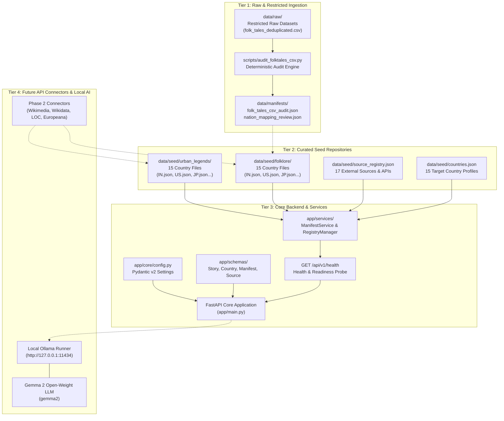
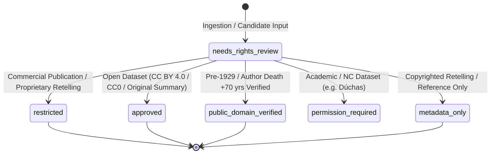
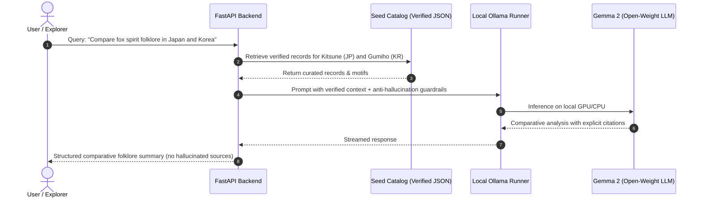

# KathaYantra — A Haunted Atlas of World Folklore
### *Preserve the story. Trace the source. Respect the culture. Keep the AI honest.*

[](https://www.python.org/)
[](https://fastapi.tiangolo.com/)
[](https://docs.pydantic.dev/)
[-success?style=flat-square&logo=pytest&logoColor=white)](tests/)
[](https://ollama.ai/)
[](LICENSE)
[](#-target-country-matrix)
[](https://hacktoberfest.com/)

---

```
  ██╗  ██╗ █████╗ ████████╗██╗  ██╗ █████╗ ██╗   ██╗ █████╗ ███╗   ██╗████████╗██████╗  █████╗ 
  ██║ ██╔╝██╔══██╗╚══██╔══╝██║  ██║██╔══██╗╚██╗ ██╔╝██╔══██╗████╗  ██║╚══██╔══╝██╔══██╗██╔══██╗
  █████╔╝ ███████║   ██║   ███████║███████║ ╚████╔╝ ███████║██╔██╗ ██║   ██║   ██████╔╝███████║
  ██╔═██╗ ██╔══██║   ██║   ██╔══██║██╔══██║  ╚██╔╝  ██╔══██║██║╚██╗██║   ██║   ██╔══██╗██╔══██║
  ██║  ██╗██║  ██║   ██║   ██║  ██║██║  ██║   ██║   ██║  ██║██║ ╚████║   ██║   ██║  ██║██║  ██║
  ╚═╝  ╚═╝╚═╝  ╚═╝   ╚═╝   ╚═╝  ╚═╝╚═╝  ╚═╝   ╚═╝   ╚═╝  ╚═╝╚═╝  ╚═══╝   ╚═╝   ╚═╝  ╚═╝╚═╝  ╚═╝
                    A  H A U N T E D   A T L A S   O F   W O R L D   F O L K L O R E
```

---

## 📖 Table of Contents

- [Overview](#-overview)
- [System Architecture](#-system-architecture)
- [Target Country Matrix](#-target-country-matrix)
- [Data Governance & Provenance Safeguards](#-data-governance--provenance-safeguards)
  - [Raw CSV Audit Findings](#raw-csv-audit-findings)
  - [Rights Classification Lifecycle](#rights-classification-lifecycle)
  - [Anti-Hallucination & AI Fiction Segregation](#anti-hallucination--ai-fiction-segregation)
- [Data Schema Specifications](#-data-schema-specifications)
- [External Source & API Registry](#-external-source--api-registry)
- [Repository Structure](#-repository-structure)
- [Quickstart & Installation](#-quickstart--installation)
- [Verification & Test Results](#-verification--test-results)
- [API Reference](#-api-reference)
- [Local AI Integration Blueprint](#-local-ai-integration-blueprint)
- [Contributing & Community Guidelines](#-contributing--community-guidelines)
- [License](#-license)

---

## 🌌 Overview

**KathaYantra** is a local-first, rights-aware digital archive and exploration platform for world folklore, traditional supernatural tales, ghost stories, and modern urban legends from **15 countries**.

Unlike commercial scrapers or black-box generative bots, KathaYantra is engineered around four core tenets:

1. **Folklore Archive:** A curated, source-verified collection of traditional myths, folk narratives, supernatural entities (yōkai, jinn, banshees, aswang), and oral traditions.
2. **Urban Legends Archive:** A documented index of modern rumors, contemporary legends, haunted sites, and unexplained encounters, grounded in verifiable media citations.
3. **Transparent Source Tracking:** Every narrative links back to an inspectable physical publication, national archive, or open academic database.
4. **Local-First Open-Weight AI:** An integrated local archivist running locally via **Ollama + Gemma 2**, assisting users in discovering comparative themes across cultures without inventing sources, fabricating legends, or sending data to third-party cloud APIs.

> **Phase 2 Milestone:** Establishes strict versioned data schemas (`2.0.0`), Draft 2020-12 JSON Schema contracts, deterministic 8-rule publication governance (`PublicationPolicy`), separate models for AI fiction (`GeneratedFictionRecord`) and candidate staging (`ImportCandidate`), full migration of all 30 country seed files to `DatasetEnvelope 2.0.0`, and **60 passing unit tests**.

---

## 🏛 System Architecture

KathaYantra is partitioned into four strictly decoupled tiers to maintain absolute legal, architectural, and data boundaries:



### Key Architectural Invariants
- **Zero Cloud Leakage:** No paid hosted LLMs, no remote vector databases, no cloud authentication mandates.
- **Fail-Safe Offline Mode:** The backend and browsing workflows function identically whether the local Ollama daemon is active or offline.
- **Deterministic Audits:** All audit and manifest computations are reproducible, idempotent, and non-destructive.

---

## 🗺 Target Country Matrix

KathaYantra targets **15 countries** with an eventual milestone quota of **300 verified stories** (15 countries × [10 folklore + 10 urban legends]):

| ISO Code | Country | Cultural Heritage Focus | Target Folklore | Target Urban Legends | Phase 1 Seed File |
|:---:|:---|:---|:---:|:---:|:---:|
| **`IN`** | India | Jataka tales, Baital Pachisi, Yakshas, Daayans, modern haunted sites | 10 | 10 | [`data/seed/folklore/IN.json`](file:///C:/Users/shrin/Desktop/Hactoberfest2026/KathaYantra/data/seed/folklore/IN.json) |
| **`US`** | United States | Colonial folklore, regional tall tales, distinct tribal lore, cryptids (Mothman) | 10 | 10 | [`data/seed/folklore/US.json`](file:///C:/Users/shrin/Desktop/Hactoberfest2026/KathaYantra/data/seed/folklore/US.json) |
| **`JP`** | Japan | Yōkai, yūrei, kaidan, Kuchisake-onna, Teke Teke, cursed media legends | 10 | 10 | [`data/seed/folklore/JP.json`](file:///C:/Users/shrin/Desktop/Hactoberfest2026/KathaYantra/data/seed/folklore/JP.json) |
| **`MX`** | Mexico | Pre-Hispanic Nahua/Maya syncretism, La Llorona, Chupacabra, La Planchada | 10 | 10 | [`data/seed/folklore/MX.json`](file:///C:/Users/shrin/Desktop/Hactoberfest2026/KathaYantra/data/seed/folklore/MX.json) |
| **`IE`** | Ireland | Tuatha Dé Danann, Aos Sí, banshees, National Folklore Collection archives | 10 | 10 | [`data/seed/folklore/IE.json`](file:///C:/Users/shrin/Desktop/Hactoberfest2026/KathaYantra/data/seed/folklore/IE.json) |
| **`GB`** | United Kingdom | Arthurian lore, Black Shuck, phantom coaches, Spring-heeled Jack, tube ghosts | 10 | 10 | [`data/seed/folklore/GB.json`](file:///C:/Users/shrin/Desktop/Hactoberfest2026/KathaYantra/data/seed/folklore/GB.json) |
| **`BR`** | Brazil | Tupi-Guarani lore, Saci-Pererê, Curupira, Boto Cor-de-Rosa, Loira do Banheiro | 10 | 10 | [`data/seed/folklore/BR.json`](file:///C:/Users/shrin/Desktop/Hactoberfest2026/KathaYantra/data/seed/folklore/BR.json) |
| **`GR`** | Greece | Mythic continuity, Kallikantzaroi (winter goblins), Vrykolakas, demotic tales | 10 | 10 | [`data/seed/folklore/GR.json`](file:///C:/Users/shrin/Desktop/Hactoberfest2026/KathaYantra/data/seed/folklore/GR.json) |
| **`CN`** | China | Classical Zhiguai (Pu Songling), fox spirits (Huli Jing), Beijing Bus 375 | 10 | 10 | [`data/seed/folklore/CN.json`](file:///C:/Users/shrin/Desktop/Hactoberfest2026/KathaYantra/data/seed/folklore/CN.json) |
| **`NG`** | Nigeria | Yoruba, Igbo, and Edo oral traditions, tricksters (Ijapa), Madam Koi Koi | 10 | 10 | [`data/seed/folklore/NG.json`](file:///C:/Users/shrin/Desktop/Hactoberfest2026/KathaYantra/data/seed/folklore/NG.json) |
| **`KR`** | South Korea | Dokkaebi, Gumiho (nine-tailed fox), Cheonyeo Gwishin, fan death, subway elevator | 10 | 10 | [`data/seed/folklore/KR.json`](file:///C:/Users/shrin/Desktop/Hactoberfest2026/KathaYantra/data/seed/folklore/KR.json) |
| **`PH`** | Philippines | Aswang, Manananggal, Kapre, Tikbalang, White Lady of Balete Drive | 10 | 10 | [`data/seed/folklore/PH.json`](file:///C:/Users/shrin/Desktop/Hactoberfest2026/KathaYantra/data/seed/folklore/PH.json) |
| **`ID`** | Indonesia | Javanese/Balinese animism, Kuntilanak, Pocong, Genderuwo, Nyi Roro Kidul | 10 | 10 | [`data/seed/folklore/ID.json`](file:///C:/Users/shrin/Desktop/Hactoberfest2026/KathaYantra/data/seed/folklore/ID.json) |
| **`EG`** | Egypt | Coptic/Islamic folklore, Afrit, Jinn, El Nedaha (Nile Siren), Baron Palace | 10 | 10 | [`data/seed/folklore/EG.json`](file:///C:/Users/shrin/Desktop/Hactoberfest2026/KathaYantra/data/seed/folklore/EG.json) |
| **`DE`** | Germany | Grimm Märchen, Sage traditions (Pied Piper, Lorelei, Rübezahl, Wolpertinger) | 10 | 10 | [`data/seed/folklore/DE.json`](file:///C:/Users/shrin/Desktop/Hactoberfest2026/KathaYantra/data/seed/folklore/DE.json) |
| **Total** | **15 Nations** | **Verified Quotas (150 Folklore + 150 Urban Legends)** | **150** | **150** | **300 Target** |

> *Honesty Statement:* Phase 1 establishes the seed schemas and directory structures for all 15 countries. In compliance with project guidelines, the published verified count is currently **0**. Quotas will only be incremented as records pass editorial rights verification in subsequent phases.

---

## 🛡 Data Governance & Provenance Safeguards

### Raw CSV Audit Findings
In Phase 1, an unreviewed candidate dataset `folk_tales_deduplicated.csv` (27.2 MB) was audited using [`scripts/audit_folktales_csv.py`](file:///C:/Users/shrin/Desktop/Hactoberfest2026/KathaYantra/scripts/audit_folktales_csv.py):

- **Total Rows:** `2,938` records across 4 columns (`source`, `nation`, `title`, `text`).
- **Domain Distribution:** 
  - `fairytalez.com`: **2,903 records (98.81%)**
  - `www.albanianliterature.net`: **25 records (0.85%)**
  - `www.worldoftales.com`: **10 records (0.34%)**
- **Missing Data:** Exactly **6 rows** lack nation labels (cataloged with source URLs in the audit manifest).
- **Exact Text Duplicates Found:** **3 pairs (6 rows)** were identified despite the file's "deduplicated" label.
- **Near-Duplicates Identified:** **15 pairs** with high token Jaccard similarity ($\ge 0.85$) differing only by typography, smart quotes, or character encodings.
- **Critical Rights Conclusion:** Public web accessibility on `fairytalez.com` **does not grant redistribution rights** for full story bodies. The raw CSV is quarantined in `data/raw/` (gitignored) and marked `needs_rights_review`. KathaYantra permits ingesting bibliographic metadata and authoring original summaries, but prohibits bulk publishing of copyrighted translations or commercial website retellings.

Detailed audit results: [`docs/folk-tales-dataset-audit.md`](file:///C:/Users/shrin/Desktop/Hactoberfest2026/KathaYantra/docs/folk-tales-dataset-audit.md)  
Cultural mapping review of all 58 nation values: [`data/manifests/nation_mapping_review.json`](file:///C:/Users/shrin/Desktop/Hactoberfest2026/KathaYantra/data/manifests/nation_mapping_review.json)

### Rights Classification Lifecycle
Every record in KathaYantra is strictly governed by a verified rights state:



### Anti-Hallucination & AI Fiction Segregation
1. **Physical Segregation:** AI-generated stories are strictly forbidden from entering `data/seed/folklore/` or `data/seed/urban_legends/` production seed files.
2. **Schema Labeling:** Synthetic content must carry `content_origin: ai_generated_fiction`.
3. **No Fabricated Provenance:** The local AI is instructed to explicitly refuse fabricating non-existent folklore archives, inventing false citations, or asserting that an urban legend is a historical fact.

---

## 📐 Data Schema Specifications

All data structures are enforced via **Pydantic v2** models in [`app/schemas/`](file:///C:/Users/shrin/Desktop/Hactoberfest2026/KathaYantra/app/schemas/):

### Core Schema: `StoryRecord`
Represents an individual folklore narrative or urban legend:

```python
class StoryRecord(BaseModel):
    id: str                   # Pattern: ^[A-Z]{2}-(FOLK|URBAN)-[0-9]{3,}$ (e.g. IN-FOLK-001)
    title: str                # Canonical title of the narrative
    country_code: str         # ISO 2-letter code validated against 15 target countries
    region_or_community: str? # Cultural / indigenous group (e.g. Navajo, Yoruba, Kyoto)
    category: CategoryEnum    # 'folklore' | 'urban_legend'
    subtype: str?             # e.g. ghost_story, jataka_tale, cryptid, warning_legend
    summary: str              # Concise synopsis (min 10 chars)
    long_description: str?    # Full narrative text (omitted in metadata_only records)
    alternate_names: list[str]# Variant or regional titles
    language: str = "en"      # Primary language code
    motifs: list[str]         # Thompson motif index codes (e.g. E235.1, G510)
    themes: list[str]         # Curatorial keywords (e.g. shapeshifting, haunted_road)
    historical_period: str?   # Earliest documented era
    variant_notes: str?       # Comparative editorial commentary
    sources: list[StorySource]# Documented bibliographic sources (min 1 required)
    source_type: str          # e.g. public_domain_anthology, academic_archive
    license: str              # Legal license notice
    rights_status: RightsEnum # approved | metadata_only | public_domain_verified | ...
    attribution_text: str?    # Required attribution statement
    canonical_url: str?       # Canonical link
    verification_status: Verif# verified | needs_review | rejected
    content_origin: OriginEnum# licensed_dataset | public_domain_source | original_summary | ...
    created_at: datetime
    updated_at: datetime
    record_version: str = "1.0.0"
```

Full schema definitions: [`docs/data-schema.md`](file:///C:/Users/shrin/Desktop/Hactoberfest2026/KathaYantra/docs/data-schema.md)

---

## 📡 External Source & API Registry

KathaYantra maintains a central source registry ([`data/seed/source_registry.json`](file:///C:/Users/shrin/Desktop/Hactoberfest2026/KathaYantra/data/seed/source_registry.json)) cataloging 17 authoritative repositories, APIs, and discovery references:

| Source Identifier | Source Name | Source Type | Integration Status | Auth Required | Coverage |
|:---|:---|:---|:---:|:---:|:---|
| `wikimedia_wikipedia_api` | Wikimedia / Wikipedia REST API | Encyclopedic API | `documented_api` | No | Global (All 15) |
| `wikidata_sparql` | Wikidata SPARQL Endpoint | Knowledge Graph API | `documented_api` | No | Global (All 15) |
| `library_of_congress_api` | Library of Congress JSON/YAML API | National Library API | `documented_api` | No | US, Global |
| `internet_archive` | Internet Archive API & Metadata | Digital Library API | `documented_api` | No | Global |
| `myths_of_ireland` | Myths of Ireland Structured Dataset | Open Dataset | `public_dataset` | No | Ireland (`IE`) |
| `japan_search` | Japan Search Cultural Heritage API | Cultural Heritage API | `documented_api` | Optional | Japan (`JP`) |
| `europeana_api` | Europeana Digital Heritage REST API | Cultural Heritage API | `requires_credentials` | Free Key | Europe (`GR`, `DE`, `IE`, `GB`) |
| `project_gutenberg` | Project Gutenberg Ebook Archive | Public Domain Ebooks | `public_dataset` | No | Global |
| `wikipedia_urban_legends_category`| Wikipedia Urban Legends by Country| Encyclopedic API | `documented_api` | No | Global (All 15) |
| `nichibunken_yokai_db` | Nichibunken Yōkai Database | Academic Database | `searchable_catalogue` | No | Japan (`JP`) |
| `ncaa_india` | National Cultural Audiovisual Archives | National Archive | `searchable_catalogue` | No | India (`IN`) |
| `cnfcp_iphan_brazil` | CNFCP / IPHAN Brazil Folklore Archive | National Archive | `searchable_catalogue` | No | Brazil (`BR`) |
| `duchas_ireland` | Dúchas National Folklore Collection | National Archive | `not_yet_verified` | No | Ireland (`IE`) |
| `urban_legends_online` | Urban Legends Online | Discovery Reference | `reference_only` | No | Global, US |
| `urban_legends_archive` | Urban Legends Archive | Discovery Reference | `reference_only` | No | Global, US, GB |
| `folklore_ai_github` | Folklore-ai GitHub Repository | Open Source Code | `reference_only` | No | India (`IN`) |
| `business_insider_urban_legends`| Business Insider World Urban Legends| Journalistic Overview| `reference_only` | No | Global |

Full source profiles: [`docs/data-sources.md`](file:///C:/Users/shrin/Desktop/Hactoberfest2026/KathaYantra/docs/data-sources.md)

---

## 📂 Repository Structure

```
KathaYantra/
├── app/
│   ├── api/routes/health.py        # GET /api/v1/health system probe
│   ├── core/config.py              # Pydantic v2 application settings
│   ├── integrations/registry.py    # Source registry query manager
│   ├── schemas/                    # Pydantic v2 data models (Schema v2.0.0)
│   │   ├── country.py              # CountryRecord & ISO code constraints
│   │   ├── dataset.py              # DatasetEnvelope 2.0.0 & dataset envelope
│   │   ├── generated_fiction.py    # GeneratedFictionRecord (isolated AI fiction)
│   │   ├── import_candidate.py     # ImportCandidate & raw staging disposition
│   │   ├── manifest.py             # DatasetManifest & quota models
│   │   ├── source.py               # StorySource & SourceRegistryItem
│   │   └── story.py                # StoryRecord & rights models
│   ├── services/                   # Governance & validation services
│   │   ├── data_validation.py      # DataQualityValidator (17 integrity checks)
│   │   ├── manifest_service.py     # Real-time actual count calculator
│   │   └── publication_policy.py   # PublicationPolicy (8-rule gating engine)
│   └── main.py                     # FastAPI application factory
├── data/
│   ├── manifests/
│   │   ├── dataset_manifest.json   # Dynamic actual counts vs 300 target
│   │   ├── folk_tales_csv_audit.json # Machine-readable audit report
│   │   └── nation_mapping_review.json # 58 nation values review mapping
│   ├── raw/
│   │   └── .gitkeep                # Raw CSV folder (CSVs gitignored)
│   ├── processed/.gitkeep          # Staged reviewed pipeline folder
│   ├── schemas/                    # Draft 2020-12 JSON Schema exports
│   │   ├── country.schema.json
│   │   ├── dataset_envelope.schema.json
│   │   ├── dataset_manifest.schema.json
│   │   ├── generated_fiction.schema.json
│   │   ├── import_candidate.schema.json
│   │   ├── source_registry.schema.json
│   │   ├── story_record.schema.json
│   │   └── story_source.schema.json
│   └── seed/
│       ├── countries.json          # 15 target countries catalog
│       ├── source_registry.json    # 17 registered sources & APIs
│       ├── folklore/               # 15 country seed files (DatasetEnvelope 2.0.0)
│       └── urban_legends/          # 15 country seed files (DatasetEnvelope 2.0.0)
├── docs/
│   ├── architecture.md             # Architecture & system boundaries
│   ├── data-schema.md              # Pydantic v2 & JSON Schema contracts
│   ├── data-sources.md             # Detailed profiles of 17 sources
│   ├── folk-tales-dataset-audit.md # Comprehensive CSV audit findings
│   ├── licensing-policy.md         # Rights, copyright, AI policy & gating
│   └── schema-versioning.md        # Semantic versioning & deprecation guide
├── scripts/
│   ├── audit_folktales_csv.py      # Deterministic CSV audit engine
│   ├── export_json_schemas.py      # Automated JSON Schema 2020-12 exporter
│   ├── migrate_seed_json.py        # Safe seed dataset migrator & linter
│   └── validate_json_datasets.py   # Comprehensive dataset quality validator
├── tests/
│   ├── test_app.py                 # Startup, CORS, and health route tests
│   ├── test_audit.py               # CSV parsing & duplicate audit tests
│   ├── test_config.py              # Configuration validation tests
│   ├── test_country_schema.py      # Country schema Phase 2 tests
│   ├── test_data_validation.py     # 17-point DataQualityValidator tests
│   ├── test_dataset_envelope.py    # Envelope structure & validation tests
│   ├── test_generated_fiction.py   # AI fiction segregation & disclaimer tests
│   ├── test_import_candidate.py    # ImportCandidate & disposition tests
│   ├── test_json_schema_export.py  # JSON Schema generation & sync tests
│   ├── test_manifest.py            # Manifest calculation tests
│   ├── test_migration.py           # Seed migration idempotent tests
│   ├── test_publication_policy.py  # 8-rule publication gate tests
│   ├── test_schemas.py             # Phase 1 schema regression tests
│   ├── test_source_registry.py     # Registry schema & honesty tests
│   ├── test_source_schema_phase2.py# StorySource Phase 2 tests
│   └── test_story_schema_phase2.py # StoryRecord Phase 2 constraint tests
├── .env.example                    # Environment template
├── .gitignore                      # Git rules (raw data & secrets protected)
├── LICENSE                         # MIT License
├── requirements.txt                # Pinned dependencies
└── README.md                       # Comprehensive guide
```

---

## 🚀 Quickstart & Installation

### Prerequisites
- **Python:** 3.11, 3.12, or 3.13
- **Git:** 2.20+
- **Ollama (Optional for Phase 1):** Installed locally with `gemma2` if testing future AI routes.

### 1. Clone & Setup
```bash
git clone https://github.com/AnshMeshram/KathaYantra.git
cd KathaYantra
```

### 2. Configure Environment
```bash
cp .env.example .env
```
*(Default settings work out of the box for local development).*

### 3. Install Dependencies
```bash
pip install -r requirements.txt
```

### 4. Execute Data Quality & Integrity Validation
To inspect and validate all 30 country seed files and manifests:
```bash
python scripts/validate_json_datasets.py
```

### 5. Check Seed File Schema Migration Status
To verify that all seed files comply with schema v2.0.0 without mutating files:
```bash
python scripts/migrate_seed_json.py --check
```

### 6. Export Draft 2020-12 JSON Schema Contracts
To regenerate or inspect canonical JSON Schemas in `data/schemas/`:
```bash
python scripts/export_json_schemas.py
```

### 7. Run the Full Test Suite
```bash
python -m pytest -v
```
*All 60 unit tests across 16 test modules run offline in ~2.6 seconds with 100% pass rate.*

### 8. Launch the Development Server
```bash
python -m uvicorn app.main:app --host 127.0.0.1 --port 8000 --reload
```
Server is live at: `http://127.0.0.1:8000`

---

## ✅ Verification & Test Results

The KathaYantra test suite covers all Phase 1 foundations and Phase 2 data governance invariants (60 passing tests across 16 suites):

| Test Module | Scope / Target Tested | Test Count | Status |
|---|---|:---:|:---:|
| `test_app.py` | FastAPI application lifecycle, CORS middleware, and health route probe | 3 | **PASS** |
| `test_audit.py` | CSV parsing, error handling, missing field detection, and duplicate auditing | 3 | **PASS** |
| `test_config.py` | Pydantic BaseSettings loading, comma-delimited CORS parsing, directory resilience | 3 | **PASS** |
| `test_country_schema.py` | Canonical CountryRecord v2.0.0, ISO alpha-2 constraints, record targets | 4 | **PASS** |
| `test_data_validation.py` | 17-point DataQualityValidator suite: duplicate IDs, missing files, manifest reconciliation | 4 | **PASS** |
| `test_dataset_envelope.py` | DatasetEnvelope v2.0.0, dataset_id convention, backward-compatible aliases | 3 | **PASS** |
| `test_generated_fiction.py` | GeneratedFictionRecord AI segregation, fiction disclaimer, AI-FIC ID pattern | 4 | **PASS** |
| `test_import_candidate.py` | ImportCandidate staging model, disposition state machine, quarantine logic | 3 | **PASS** |
| `test_json_schema_export.py` | Draft 2020-12 JSON Schema generation, $defs handling, contract synchronization | 2 | **PASS** |
| `test_manifest.py` | DatasetManifest dynamic calculation, target quotas vs actual published counts | 2 | **PASS** |
| `test_migration.py` | Seed migration script idempotent upgrades, --check dry run mode | 2 | **PASS** |
| `test_publication_policy.py` | 8-rule deterministic PublicationPolicy evaluation and gating invariants | 7 | **PASS** |
| `test_schemas.py` | Phase 1 schema regression tests: ISO validation, category constraints, URL schemes | 6 | **PASS** |
| `test_source_registry.py` | 17 registered sources schema conformance, honest access reporting, filtering | 4 | **PASS** |
| `test_source_schema_phase2.py` | StorySource v2.0.0, attribution requirements, full-text reuse flags | 4 | **PASS** |
| `test_story_schema_phase2.py` | StoryRecord v2.0.0: ID prefix matching, AI fiction rejection, length constraints | 6 | **PASS** |
| **Total** | **16 Test Suites Covering Phases 1 & 2** | **60** | **ALL PASS** |

---

## ⚡ API Reference

### Health & Readiness Probe
`GET /api/v1/health`

Returns application metadata, configuration status, dataset availability flags, true story counts, and local AI state without blocking:

```json
{
  "status": "ok",
  "app_name": "KathaYantra",
  "app_version": "0.1.0",
  "config_loaded": true,
  "datasets_available": {
    "countries_json": true,
    "source_registry_json": true,
    "folklore_seed_dir": true,
    "urban_legends_seed_dir": true,
    "raw_csv": true,
    "manifest_json": true,
    "nation_mapping_json": true,
    "audit_json": true
  },
  "counts": {
    "target_countries": 15,
    "actual_total_stories": 0,
    "required_total_stories": 300,
    "target_per_country_folklore": 10,
    "target_per_country_urban_legends": 10
  },
  "local_ai": {
    "configured_model": "gemma2",
    "base_url": "http://127.0.0.1:11434",
    "ollama_available": false,
    "note": "Local-first AI runner; Ollama is optional for browsing and data validation."
  }
}
```

### Interactive Documentation
When running locally:
- **Swagger UI:** `http://127.0.0.1:8000/docs`
- **ReDoc:** `http://127.0.0.1:8000/redoc`

---

## 🧠 Local AI Integration Blueprint

KathaYantra is designed to interface with **Gemma 2** running locally through **Ollama**:



- **Environment Config:** Configurable via `OLLAMA_BASE_URL` (default: `http://127.0.0.1:11434`) and `OLLAMA_MODEL` (default: `gemma2`).
- **Zero Hallucination Guarantee:** The LLM receives curated story records as grounded context. If a tradition is unverified or absent from the archive, the AI explicitly states that no documented record exists rather than inventing lore.

---

## 🤝 Contributing & Community Guidelines

Contributions to KathaYantra are welcomed as part of **Hacktoberfest 2026** and open-source cultural preservation initiatives!

### Ingestion Guidelines for Contributors:
1. **Source Citation is Mandatory:** Every proposed folklore or urban-legend record must link to an authenticated historical archive, scholarly publication, or verified news source.
2. **No Unattributed Web Scraping:** Do not submit copyrighted retellings copied from commercial blogs or modern anthologies.
3. **Write Original Summaries:** Contributors should write original, concise narrative summaries based on public-domain source materials.
4. **Indigenous Attribution:** Stories from Indigenous communities must specify the sovereign tribal nation or cultural group rather than a modern generic nation-state.
5. **Run Tests Before Submitting:**
   ```bash
   python -m pytest -v
   ```

---

## 📄 License

This project is licensed under the **MIT License** — see the [LICENSE](LICENSE) file for details.

### Cultural Attribution & Rights Notice
Folklore narratives, mythological figures, and traditional motifs belong to the shared cultural heritage of humanity and their respective cultural communities. KathaYantra aims to preserve and index these narratives with inspectable bibliographic provenance and cultural respect.
