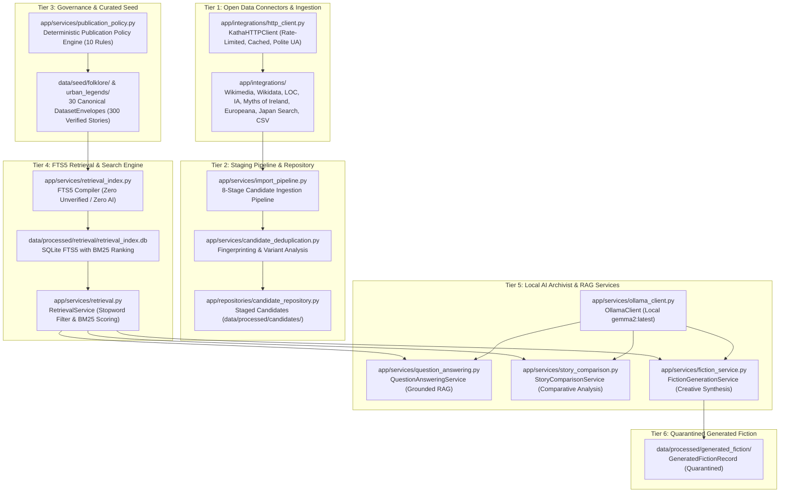
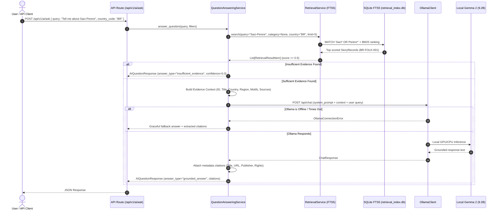

# KathaYantra Backend Architecture (Phase 5)

> **Central Principle:**  
> _Preserve the story. Trace the source. Respect the culture. Keep the AI honest._

---

## 1. Architectural Overview

KathaYantra is designed as a **local-first, rights-aware digital archive, exploration engine, and grounded AI assistant** for world folklore and urban legends across 15 target countries.

In Phase 5, the architecture introduces **the Local AI Archivist subsystem**:
- **Ollama Client (`app/services/ollama_client.py`):** Asynchronous HTTP client communicating with a locally running Ollama instance hosting Google's open-weight `gemma2` model, with health checks, timeout resilience, and retry policies.
- **SQLite FTS5 Retrieval Engine (`app/services/retrieval_index.py`, `app/services/retrieval.py`):** Standalone full-text search index (`data/processed/retrieval/retrieval_index.db`) compiling all 300 verified stories with BM25 ranking, conversational stopword filtering, and metadata filtering.
- **Grounded Q&A Service (`app/services/question_answering.py`):** Multi-stage RAG pipeline retrieving authentic records, assembling evidence contexts, prompting Gemma 2 with strict evidence boundaries, and extracting verifiable citations directly from catalog metadata.
- **Comparative Analysis Service (`app/services/story_comparison.py`):** Cross-cultural comparison engine examining motifs, cultural contexts, regional variants, and differences without assuming false genealogical transmission.
- **Isolated Fiction Generation Service (`app/services/fiction_service.py`):** Creative storytelling engine generating synthetic narratives inspired by authentic motifs, strictly encapsulated in `GeneratedFictionRecord` models and quarantined in `data/processed/generated_fiction/`.
- **Offline Resilience:** 100% of the archive browsing, search, and validation operations function without degradation when Ollama is offline, with graceful degradation responses for AI endpoints.



---

## 2. Decoupled Ingestion & Staging Pipeline

A critical Phase 2 enhancement is the formal decoupling of incomplete incoming data from published cultural records:

```mermaid
sequenceDiagram
    autonumber
    actor Curator as Ingestion Pipeline / Curator
    participant Raw as Raw Source Data (CSV / API)
    participant Staging as ImportCandidate (Staging)
    participant Policy as PublicationPolicy Service
    participant Seed as DatasetEnvelope (Curated Seed)
    participant AI as Local AI (Gemma 2)

    Curator->>Raw: Harvest or audit raw inputs
    Raw->>Staging: Ingest into ImportCandidate (new_candidate)
    Note over Staging: Incomplete fields, unverified URLs, missing country allowed in staging
    Curator->>Staging: Review rights, nation mapping, and write original summary
    Staging->>Policy: Submit candidate for publication review
    alt Passes All 8 Policy Checks
        Policy->>Seed: Promote to StoryRecord in DatasetEnvelope
    else Fails Policy (e.g. Needs Rights Review or Unverified)
        Policy-->>Curator: Return validation violations; remain in staging
    end
    AI-->>Curator: Generates creative story with mandatory disclaimer
    Note over AI: AI fiction saved strictly to GeneratedFictionRecord; rejected by StoryRecord
```

---

## 3. The 17 Data Quality Checks

The `DataQualityValidator` ([`app/services/data_validation.py`](file:///C:/Users/shrin\Desktop\Hactoberfest2026\KathaYantra\app\services\data_validation.py)) evaluates:

1. **JSON Syntax:** Clean JSON parsing without truncation or syntax errors.
2. **Dataset Envelope:** Proper `DatasetEnvelope` root structure (`schema_version: "2.0.0"`).
3. **Country/Category Alignment:** File `IN.json` in `folklore/` must declare `country_code: "IN"` and `category: "folklore"`.
4. **Story Schema Conformance:** Validates every record against `StoryRecord`.
5. **Stable ID Format:** Matches `^[A-Z]{2}-(FOLK|URBAN)-[0-9]{3,}$`.
6. **Global Duplicate IDs:** Zero duplicate record IDs across all 30 seed files.
7. **Recurring Titles:** Identifies duplicate titles across regions for editorial review.
8. **Source URL Validity:** Enforces valid HTTP/HTTPS schemes and network locations.
9. **Mandatory Sources:** Every story record must contain $\ge 1$ traceable source.
10. **Rights Status Presence:** Assesses explicit legal rights state.
11. **Unverified Records:** Prevents unverified records from being labeled "approved".
12. **Prefix Consistency:** Enforces that record ID prefixes match country code and category tag.
13. **AI Fiction Segregation:** Rejects any record with `content_origin: ai_generated_fiction` from seed files.
14. **Manifest Discrepancy:** Verifies that actual counts match manifest totals.
15. **Source Registry References:** Verifies citation links to `source_registry.json`.
16. **Controlled Enums:** Restricts categories, verification states, and rights to approved enums.
17. **Timestamps & Languages:** Validates ISO 8601 UTC timestamps and ISO language codes.

---

## 4. Key Archival Invariants

- **Curated Published Archive:** 300 verified stories (150 folklore + 150 urban legends, 20 per country across 15 countries) pass all 10 `PublicationPolicy` rules with 100% genuine bibliographic citations.
- **Quarantined Raw Corpus:** The 2,938-row `folk_tales_deduplicated.csv` remains strictly in `data/raw/` (gitignored).
- **Draft 2020-12 Contract Exports:** Machine-readable schemas in `data/schemas/` are regenerated automatically from Pydantic models.
- **Fail-Safe Local AI:** The entire backend and validation suite operates with 100% functionality when Ollama is offline.
- **Strict Evidence Grounding:** Factual AI responses cite only genuine records retrieved from the database; model memory hallucinations and fabricated URLs are strictly prohibited.
- **Quarantined Synthetic Fiction:** All AI-generated fiction records are segregated into `data/processed/generated_fiction/` and barred from seed files.

---

## 5. Phase 5 Local AI Archivist Architecture


