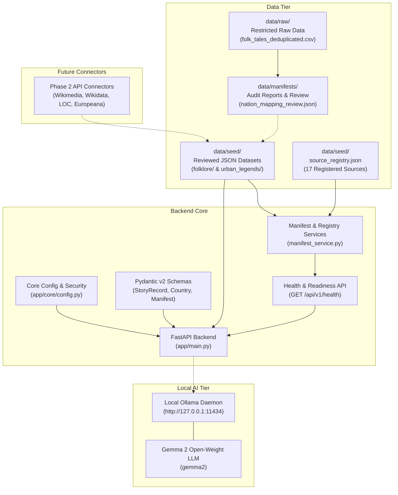
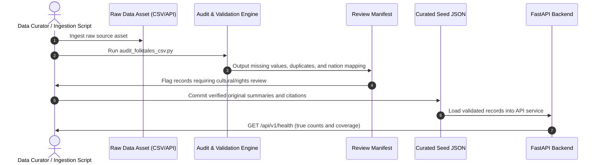

# KathaYantra Backend Architecture

> **Central Principle:**  
> *Preserve the story. Trace the source. Respect the culture. Keep the AI honest.*

---

## 1. Architectural Overview

KathaYantra is designed as a **local-first, rights-aware digital archive and exploration engine** for world folklore and urban legends across 15 target countries.

The backend is built with Python 3, FastAPI, Pydantic v2, and version-controlled JSON seed repositories, designed to integrate seamlessly with a locally running open-weight large language model (**Ollama + Gemma 2**) without relying on paid hosted LLMs, cloud databases, or third-party vector databases.

---

## 2. Strict Boundary Separation

A primary architectural requirement is strict segregation between raw unreviewed data, reviewed seed collections, future API ingestions, and AI services:

### A. Raw Data Tier (`data/raw/`)
- Contains untouched, incoming data assets (e.g. `folk_tales_deduplicated.csv`).
- Protected by `.gitignore` to prevent unauthorized publication in public repositories.
- Records are classified as `needs_rights_review` and are **never** directly exposed via the public API or mixed with verified stories.

### B. Curated Seed Datasets (`data/seed/`)
- Version-controlled, human-inspectable JSON files.
- Structured by country code (`data/seed/folklore/<CODE>.json` and `data/seed/urban_legends/<CODE>.json`).
- Every story record must pass strict Pydantic schema validation, including documented sources, verified license state, cultural provenance, and rights classification.
- In Phase 1, all 30 files are initialized with documented, empty structures (`records: []`) to accurately reflect actual curated status.

### C. Future API Ingestion Tier (`app/integrations/`)
- Standardized connectors to external archives (Library of Congress, Wikimedia, Europeana, Japan Search).
- Governed by `data/seed/source_registry.json`.
- Enforces rate limits, attribution requirements, and credential segregation (e.g., API keys in `.env`).

### D. Local AI Inference Tier (Ollama + Gemma 2)
- Architecture: `Curated JSON data + approved metadata -> Retrieval Service -> FastAPI -> Ollama / Gemma 2`.
- AI outputs are strictly segregated using `content_origin: ai_generated_fiction`.
- The AI is **never** permitted to fabricate folklore sources, invent historical events, or act as an authoritative substitute for historical provenance.
- The system is completely resilient: if Ollama is offline or uninstalled, the archive browsing, search, and validation workflows function without disruption.

---

## 3. Data Flow and Ingestion Pipeline

---

## 4. Key Invariants

1. **Source Provenance:** Every single story record must have at least one validated source citation with a functioning URL.
2. **Deterministic Processing:** Auditing and manifest generation scripts are deterministic, idempotent, and non-destructive.
3. **No Phantom Quotas:** Actual counts reflect strictly validated records. The target of 300 records is documented as a milestone, never faked.
4. **Cultural Integrity:** Regional, ethnic, and Indigenous traditions (e.g., Native American, Hawaiian, Celtic, Yoruba) are preserved with specific cultural attribution rather than flattened into modern national borders.
5. **Zero Cloud Dependencies:** No paid cloud APIs, external vector databases, or hosted LLM endpoints.

