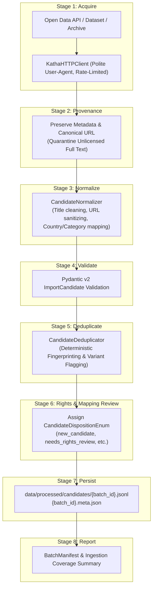

# KathaYantra Data Import and Candidate Staging Pipeline

> **Core Archival Invariant:**  
> *Documented source → API response or approved dataset → raw-data handling → normalisation → ImportCandidate → validation → rights review → editorial review → future publication*

---

## 1. Pipeline Overview

The KathaYantra Import Pipeline provides a structured, rights-aware, and reproducible process for acquiring cultural narrative metadata from registered open-data APIs, public datasets, and physical archival references.

Unlike web scrapers that bulk-harvest copyrighted retellings directly into production databases, KathaYantra decouples raw acquisition from publication through an intermediate staging model: **`ImportCandidate`**.

---

## 2. The 8 Stages in Detail

### Stage 1 — Acquire
- Outgoing requests use `KathaHTTPClient` with a contactable User-Agent, bounded concurrency (`HTTP_MAX_CONCURRENCY`), configurable timeouts, and exponential backoff retry.
- Respects `Retry-After` headers on HTTP 429 rate-limiting responses.
- Enforces response size safeguards (`MAX_RESPONSE_SIZE_BYTES = 50 MB`) to prevent memory exhaustion.

### Stage 2 — Preserve Permissible Raw Provenance
- Retains external accession IDs, original source URLs, publisher notes, and licensing metadata.
- **Copyright Invariant:** Proprietary full-text narrative bodies (e.g. from commercial blogs or Fairytalez retellings) are **never** persisted into public seed files or candidate exports. Only bibliographic metadata and concise summaries are staged.

### Stage 3 — Normalize
- Strips tracking query parameters (`utm_*`, `ref`) from source URLs.
- Cleans and unescapes HTML entities in titles.
- Validates country codes against the 15 supported ISO alpha-2 codes (`SUPPORTED_COUNTRY_CODES`).
- Coerces categories strictly to `CategoryEnum.FOLKLORE` or `CategoryEnum.URBAN_LEGEND`.

### Stage 4 — Validate
- Every candidate is validated against Pydantic model `ImportCandidate` (Schema v2.0.0).
- Malformed payloads are flagged with validation errors and assigned `disposition = rejected` without halting the batch run.

### Stage 5 — Deduplicate & Variant Analysis
- Calculates a deterministic SHA-256 fingerprint:  
  `sha256(source_id:external_id:raw_url:title)`
- If fingerprint matches an existing candidate, disposition is set to `duplicate_candidate`.
- Computes Jaccard lexical similarity between titles across different cultural traditions. If similarity is high ($\ge 45\%$), the pipeline **flags a variant review note** to assist human curators, **strictly refusing to merge distinct regional traditions**.

### Stage 6 — Rights and Mapping Review
Assigns one of the eight canonical disposition states:
- `new_candidate`: Ingested item awaiting curation.
- `needs_mapping_review`: Unmapped, missing, or ambiguous nation label (e.g. `north_american_native`).
- `needs_source_verification`: Missing canonical URL or unverified accession record.
- `needs_rights_review`: Provenance from a source whose full-text rights are unverified.
- `eligible_for_editorial_review`: Country mapped, source verified, and open/PD rights verified.
- `approved_for_publication`: Passed curatorial and editorial review.
- `duplicate_candidate`: Exact identical record already staged.
- `rejected`: Malformed, offensive, or inappropriate content.

### Stage 7 — Persist Staged Candidates
- Staged candidates are saved atomically to `data/processed/candidates/{batch_id}.jsonl`.
- Batch summary metadata is saved alongside as `{batch_id}.meta.json`.
- In `--dry-run` mode, file writing is skipped completely.

### Stage 8 — Report
- Emits a structured `BatchManifest` capturing retrieved count, accepted count, duplicates, rights-pending count, and processing errors.

---

## 3. CLI Tools Reference

| Tool | Source Integrated | Example Command |
|---|---|---|
| [`scripts/discover_wikimedia.py`](file:///C:/Users/shrin/Desktop/Hactoberfest2026/KathaYantra/scripts/discover_wikimedia.py) | Wikimedia REST API | `python scripts/discover_wikimedia.py --query "Baital Pachisi" --country IN --limit 10` |
| [`scripts/discover_wikidata.py`](file:///C:/Users/shrin/Desktop/Hactoberfest2026/KathaYantra/scripts/discover_wikidata.py) | Wikidata SPARQL | `python scripts/discover_wikidata.py --query "Kitsune" --country JP --limit 10` |
| [`scripts/import_library_of_congress.py`](file:///C:/Users/shrin/Desktop/Hactoberfest2026/KathaYantra/scripts/import_library_of_congress.py) | Library of Congress JSON API | `python scripts/import_library_of_congress.py --query "Paul Bunyan" --limit 15` |
| [`scripts/import_internet_archive.py`](file:///C:/Users/shrin/Desktop/Hactoberfest2026/KathaYantra/scripts/import_internet_archive.py) | Internet Archive Advanced Search | `python scripts/import_internet_archive.py --query "Irish fairy tales" --country IE --limit 10` |
| [`scripts/import_myths_of_ireland.py`](file:///C:/Users/shrin/Desktop/Hactoberfest2026/KathaYantra/scripts/import_myths_of_ireland.py) | Myths of Ireland Open Dataset | `python scripts/import_myths_of_ireland.py --query "all" --limit 20` |
| [`scripts/import_europeana.py`](file:///C:/Users/shrin/Desktop/Hactoberfest2026/KathaYantra/scripts/import_europeana.py) | Europeana REST API | `python scripts/import_europeana.py --query "Grimm" --country DE --limit 10` |
| [`scripts/import_japan_search.py`](file:///C:/Users/shrin/Desktop/Hactoberfest2026/KathaYantra/scripts/import_japan_search.py) | Japan Search Platform | `python scripts/import_japan_search.py --query "妖怪" --limit 10` |
| [`scripts/import_folktales_csv.py`](file:///C:/Users/shrin/Desktop/Hactoberfest2026/KathaYantra/scripts/import_folktales_csv.py) | Quarantined Raw CSV | `python scripts/import_folktales_csv.py --country BR --limit 20` |
| [`scripts/validate_import_candidates.py`](file:///C:/Users/shrin/Desktop/Hactoberfest2026/KathaYantra/scripts/validate_import_candidates.py) | Staged Candidates Validator | `python scripts/validate_import_candidates.py` |
| [`scripts/report_import_batches.py`](file:///C:/Users/shrin/Desktop/Hactoberfest2026/KathaYantra/scripts/report_import_batches.py) | Ingestion Coverage Reporter | `python scripts/report_import_batches.py [--json]` |

---

## 4. Quota and Target Integrity

- Target quota remains **15 countries × 20 stories = 300 stories**.
- **Crucial Policy:** Ingesting 50 candidates into `data/processed/candidates/` does **NOT** increment published story counts in `data/manifests/dataset_manifest.json`.
- Only records that pass the Phase 2 `PublicationPolicy` (verified source, clear rights, authentic origin, human curatorial approval) are migrated to `data/seed/folklore/` or `data/seed/urban_legends/`.
