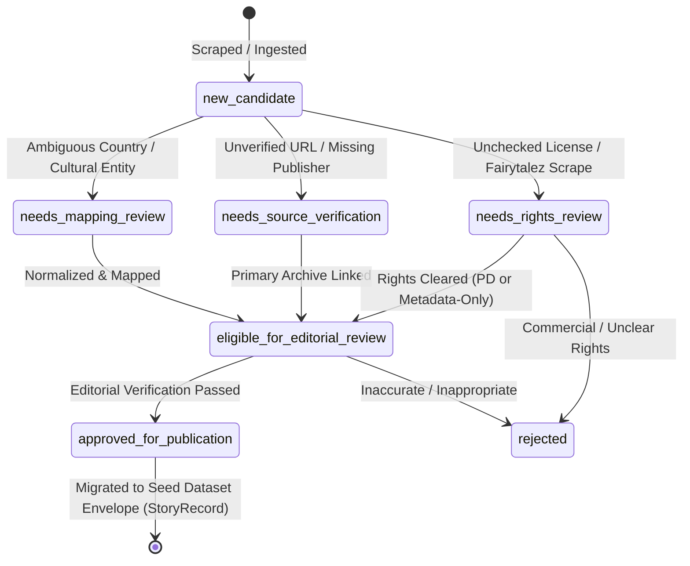

# KathaYantra Copyright, Provenance and Licensing Policy

> **Guiding Principle:**  
> *Preserve the story. Trace the source. Respect the culture. Keep the AI honest.*

---

## 1. Core Principles

KathaYantra is committed to rigorous legal compliance, archival integrity, and cultural respect:

1. **Inspectable Provenance:** Every story record in KathaYantra must link to an authenticated historical document, scholarly archive, or verified community citation.
2. **Public Access vs. Redistribution Rights:** The fact that a text or image is viewable on a public website does **not** grant permission to scrape, copy, or redistribute that content.
3. **Tradition vs. Expression:** While ancient folklore motifs (e.g., Cinderella, Anansi, Baital Pachisi) are part of the shared public domain, **modern translations, adaptations, editorial commentary, and specific prose retellings are protected by copyright**.
4. **Cultural Sovereignty:** Oral traditions belonging to Indigenous, First Nations, and traditional communities must be attributed to their specific sovereign communities rather than subsumed under modern national labels.
5. **Honest AI Segregation:** Synthetic stories created by local AI (Gemma 2) must be explicitly designated as `ai_generated_fiction` and never intermingled with historical folklore records.

---

## 2. Policy on the Supplied Raw CSV (`folk_tales_deduplicated.csv`)

An initial dataset of 2,938 folk tale records was supplied at the project inception. An audit conducted in Phase 1 established that:
- Over 98.8% (2,903 records) originate from `fairytalez.com`.
- Remaining records originate from `albanianliterature.net` (Robert Elsie collection) and `worldoftales.com`.
- These websites retain compilation, design, and editorial copyright over their retold prose.

### Archival Mandates for the Raw CSV:
1. **Restricted Storage:** The raw CSV is archived at `data/raw/folk_tales_deduplicated.csv` and excluded from public version control via `.gitignore`.
2. **No Bulk Redistribution:** Full story bodies from the raw CSV must **not** be ingested wholesale into KathaYantra's published seed datasets or emitted by the public REST API.
3. **Rights Assessment Status:** All records from this CSV are marked `rights_status: needs_rights_review`.
4. **Permitted Derivative Ingestion:** Future phases may ingest bibliographic metadata (title, nation, source URL) and author original, independent summaries of the underlying traditional tales.

---

## 3. Rights Assessment Classifications

Every story record in KathaYantra is categorized into one of seven explicit rights states:

| Status Code | Definition | Allowed Usage in KathaYantra |
|---|---|---|
| `approved` | Clear open license verified (e.g. CC0, CC BY 4.0, or KathaYantra original summary). | Full text and metadata published. |
| `public_domain_verified` | Author death > 70 years ago, publication pre-1929, or government public domain. | Full historical text published with attribution. |
| `metadata_only` | Underlying text is copyrighted or unverified; citation and summary permitted. | Only title, summary, source links, and metadata displayed. |
| `needs_rights_review` | Newly discovered or candidate source; rights status unconfirmed. | Restricted to staging/internal audit; not published. |
| `permission_required` | Educational or institutional source requiring explicit written consent (e.g. CC BY-NC). | Held pending formal outreach or restricted to metadata. |
| `restricted` | Commercial or proprietary publication (e.g. modern newspaper article, book publisher). | Reference and citation only; zero text ingestion. |
| `unknown` | Undocumented source or missing licensing data. | Treated as restricted until investigated. |

---

## 4. Policy on AI-Generated Fiction & Grounded Archivist Intelligence

KathaYantra integrates local open-weight AI (Ollama + Gemma 2 9.2B) to assist users in exploring authentic folklore, comparing regional variants, and generating creative fiction inspired by traditional motifs.

To prevent hallucinations, cultural misrepresentation, historical distortion, and legal contamination:

1. **Mandatory Schema Classification:** All AI-generated narratives must instantiate `GeneratedFictionRecord` with `content_type: "ai_generated_fiction"`. The authentic `StoryRecord` schema validator actively rejects any record tagged with AI fiction.
2. **Strict Physical Quarantine:** AI-generated stories are strictly forbidden from entering `data/seed/folklore/` or `data/seed/urban_legends/`. They are persisted exclusively within `data/processed/generated_fiction/`.
3. **Mandatory Disclaimer:** Every generated fiction record carries an immutable disclosure: *"This is a modern creative fiction work generated by local AI, inspired by traditional folklore motifs. It is not an authentic historical narrative, sacred tradition, or verified cultural legend."*
4. **Metadata-Derived Citations Only:** Factual AI responses attach bibliographic citations extracted directly from verified catalog metadata. The local model is strictly forbidden from inventing URLs, book titles, publishers, or historical references.
5. **No Speculative History / Refusal Invariant:** When user queries address topics, figures, or supernatural entities not present in the verified dataset, the archivist explicitly reports insufficient evidence rather than confabulating folklore.
6. **Local-First & Offline Privacy:** All model inference runs strictly on the user's local hardware via Ollama. No user prompts, catalog stories, or queries are ever transmitted to third-party cloud APIs.

---

## 5. Cultural Context and Indigenous Narratives

- **Indigenous Communities:** Folk tales from Indigenous communities (e.g. Native American, First Nations, Aboriginal Australian, Māori, Sámi) must not be generalized into generic nation-state containers without specifying the tribal nation or community origin.
- **Respect for Sacred Narratives:** Traditions designated as sacred or restricted by their originating communities must not be harvested or adapted for entertainment.
- **Living Urban Legends:** Urban legends regarding living persons, active criminal investigations, or malicious hoaxes are excluded from publication to uphold ethical and safety standards.

---

## 6. Phase 2 Publication Policy Engine

KathaYantra Phase 2 implements a strict, deterministic publication gate (`PublicationPolicy` in [`app/services/publication_policy.py`](file:///C:/Users/shrin/Desktop/Hactoberfest2026/KathaYantra/app/services/publication_policy.py)) evaluating every candidate record before it can be published or counted towards verified target metrics:

1. **Schema Compliance:** The record must validate strictly against Pydantic `StoryRecord` v2.0.0 without unknown fields or malformed types.
2. **Deterministic ID Prefix Match:** The record ID must match `^[A-Z]{2}-(FOLK|URBAN)-[0-9]{3,}$`, and the prefix must match both the country code and category tag (e.g. `IN-FOLK-001` for India folklore, `JP-URBAN-001` for Japan urban legends).
3. **Supported Country Registration:** The country code must belong to the 15 supported national archives (`IN`, `US`, `JP`, `MX`, `IE`, `GB`, `BR`, `GR`, `CN`, `NG`, `KR`, `PH`, `ID`, `EG`, `DE`).
4. **Authentic Content Origin:** Synthetic fiction (`ai_generated_fiction`) is strictly prohibited from entering `StoryRecord` and rejected by the validator. Only authentic cultural origins (`licensed_dataset`, `public_domain_source`, `original_summary`, `community_contribution`, `verified_archive`) are permitted.
5. **Curated Summary Completeness:** Every story summary must be substantive, informative, and at least 30 characters in length.
6. **Traceable Source Provenance:** At least one valid, documented bibliographic source (`StorySource`) with an authenticated `url` or `canonical_url` and valid scheme (`http`/`https`) is required.
7. **Curatorial Editorial Status:** The record must have an explicit verification status of `verified`. Candidates marked `needs_review` or `rejected` are excluded from published metrics.
8. **Rights Clearance & Attribution:** The rights status must be cleared (`approved`, `public_domain_verified`, or `metadata_only`). If attribution is legally required by the license, non-empty `attribution_text` must be present.

---

## 7. Metadata-Only Record Constraints

When a cultural record's narrative prose is proprietary, commercial, or copyrighted by a third-party anthology:
- The record's `rights_status` must be set to `metadata_only`.
- Full narrative prose (`long_description`) must **never** contain copyrighted full text; it is omitted or restricted to a scholarly citation overview.
- The record must provide an authoritative `canonical_url` and explicit `attribution_text` directing users to the primary source or published work.

---

## 8. Candidate Lifecycle & State Transitions

Raw and scraped records never enter the seed datasets directly. They progress through a staged lifecycle:

